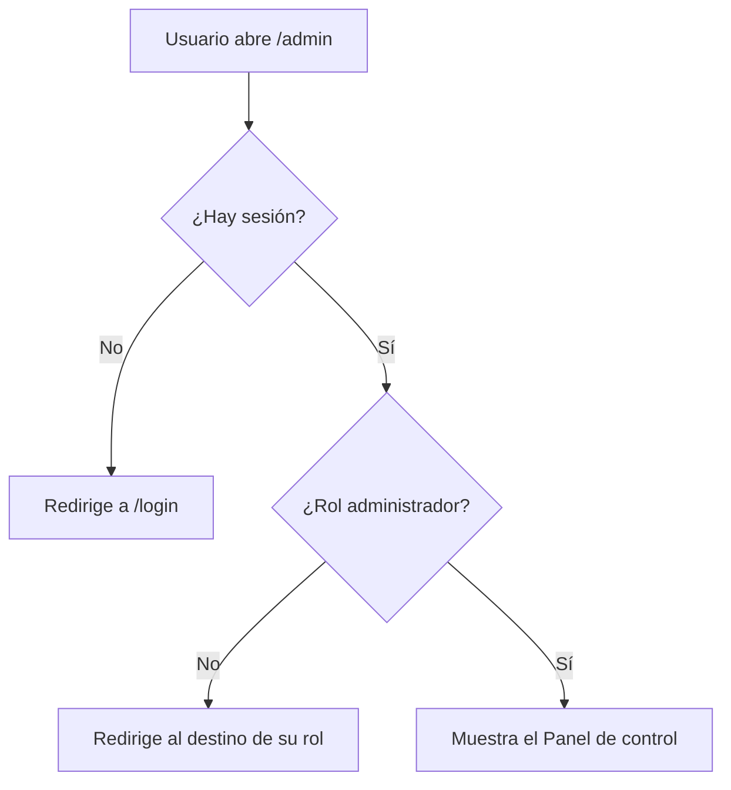

# HU18 · Acceso restringido al panel de administración (Frontend)

Documento para entender el panel de control del administrador: qué muestra, qué hace cada componente, cómo se restringe el acceso y cómo probarlo.

- **Fecha:** 8 de octubre de 2026
- **HU:** HU18 · Acceso restringido al panel de administración (1 punto)
- **Rama:** `feature/front/panel-admin`
- **Metodología:** esta HU **no se desarrolló con TDD**; los tests se añadieron después de la implementación
- **Depende de:** `docs/hu2-login.md` (sesión, rutas protegidas y cabecera)

---

## 1. Resumen

El administrador accede a un **panel de control** con tres tarjetas, una por tipo de usuario a gestionar:

| Tarjeta | Descripción mostrada |
|---|---|
| Clientes | Consulta y gestiona las cuentas de los clientes de ESIBuy. |
| Vendedores | Supervisa a los vendedores y consulta sus catálogos. |
| Administradores | Gestiona al equipo con acceso al panel de control. |

**Alcance actual:** las tarjetas son botones con aspecto y animaciones completas, pero **todavía no ejecutan ninguna acción**. La gestión de cada tipo de usuario llegará con las historias HU19 a HU24 y HU26.

---

## 2. Cómo se cumplen los criterios de aceptación

| Criterio | Cómo se cumple |
|---|---|
| Solo el administrador ve la opción en el menú | `AppHeader` muestra el enlace "Panel de control" únicamente si `user.rol` es `ADMINISTRADOR`. |
| Sin sesión, redirección al login | La ruta `/admin` está envuelta en `ProtectedRoute`; sin sesión navega a `/login`. |
| Otro rol no accede | Un cliente o vendedor que escriba `/admin` es redirigido al destino de su propio rol. |

> Ocultar el enlace y redirigir son medidas de **experiencia de usuario**. La barrera real de seguridad es el backend, que debe devolver 401 o 403 en cualquier llamada de administración sin los permisos adecuados.

---

## 3. Flujo de acceso



Con sesión de administrador, también se llega desde la cabecera: aparece el enlace **Panel de control**, junto a "Cerrar sesión". Tras iniciar sesión, el administrador aterriza directamente en `/admin`.

---

## 4. Componentes y archivos

Todas las rutas son relativas a `frontend/src/`.

| Archivo | Acción | Qué hace |
|---|---|---|
| `pages/AdminPage.jsx` | Modificado | Página `/admin`. Título "Panel de control", subtítulo y rejilla con las tres tarjetas. La lista de secciones está en un array, de modo que añadir otra es una entrada más. |
| `features/admin/AdminSectionCard.jsx` | Nuevo | Tarjeta reutilizable: icono, título, descripción y flecha. Recibe `icon`, `title`, `description` y, opcionalmente, `onClick`. |
| `components/AppHeader.jsx` | Modificado | Añade el enlace "Panel de control", visible solo para administradores. |
| `pages/AdminPage.test.jsx` | Nuevo | Tests del panel. |
| `components/AppHeader.test.jsx` | Modificado | Añade los tests de la opción de menú. |

Sin cambios, pero relevantes: `routes/AppRoutes.jsx` (ya registraba `/admin` bajo `ProtectedRoute` con el rol administrador), `auth/roles.js` y `routes/paths.js`.

### La tarjeta (`AdminSectionCard`)

- Es un **`<button>` nativo** estilizado con tokens de Fluent UI. Así tiene semántica de botón, se activa con Enter y Espacio y recibe foco de teclado sin lógica adicional.
- **Animaciones** (al pasar el ratón o enfocar con teclado):
  - La tarjeta se eleva ligeramente y gana sombra y borde de color de marca.
  - El círculo del icono se rellena con el color de marca y crece un poco.
  - La flecha se hace plenamente visible y se desplaza a la derecha.
  - Al pulsar, la tarjeta se "hunde" un poco.
- **Accesibilidad:** indicador de foco visible (`focus-visible`), iconos marcados como decorativos y respeto a la preferencia del sistema *reducir movimiento*, con la que desaparecen las animaciones de desplazamiento.
- **Responsive:** la rejilla usa `auto-fit`, así que pasa de tres columnas a una sola en pantallas estrechas sin desbordar.
- El estado de "activo" (ratón o foco) se controla con un `useState` interno, porque Griffel (el motor de estilos de Fluent) no permite estilar hijos desde el `:hover` del padre.

---

## 5. Cómo conectar las tarjetas más adelante

Cuando exista cada pantalla de gestión, solo hay que pasar la acción a la tarjeta desde `AdminPage`:

```jsx
const navigate = useNavigate()

<AdminSectionCard
  title="Clientes"
  /* ... */
  onClick={() => navigate('/admin/customers')}
/>
```

Y añadir la ruta correspondiente en `routes/paths.js` y `routes/AppRoutes.jsx`, dentro de `ProtectedRoute` con el rol administrador. HU19 (listar y buscar usuarios) será el primer consumidor.

---

## 6. Cómo probarlo

### A mano (con `npm run dev`)

1. Iniciar sesión con `admin@esibuy.test` / `Mock-Clave-1!` (código de correo `654321`, código de Authenticator `123456`). Debe aterrizar en `/admin`.
2. Comprobar el título **Panel de control** y las tres tarjetas.
3. Pasar el ratón por cada tarjeta y comprobar la elevación, el icono relleno y la flecha. Repetir con el teclado (Tab) y comprobar el indicador de foco.
4. Reducir el ancho de la ventana (F12, modo móvil) y comprobar que las tarjetas se apilan sin desbordar.
5. Pulsar una tarjeta: de momento **no pasa nada**, y es lo esperado.
6. Cerrar sesión e iniciar con `cliente@esibuy.test` o `vendedor@esibuy.test`: la cabecera **no** muestra "Panel de control", y escribir `/admin` en la barra de direcciones redirige a su zona.
7. Sin sesión, abrir `/admin`: debe llevar a `/login`.

### Automáticos

```bash
npx vitest run     # 51 tests en total
npm run lint
npm run build
```

Los tests propios de esta HU:

| Archivo | Qué comprueba |
|---|---|
| `AdminPage.test.jsx` | Título, tres botones, foco por teclado, que pulsar no navega, redirección sin sesión y con rol vendedor |
| `AppHeader.test.jsx` | El enlace aparece solo para administradores, lleva a `/admin` y no aparece ni sin sesión ni con otros roles |

---

## 7. Limitaciones y trabajo pendiente

- Las tarjetas aún no hacen nada. Un botón sin acción puede confundir a un usuario real; conviene que HU19 las conecte pronto o, si el panel se despliega antes, añadir una etiqueta "Próximamente".
- Las descripciones de las tarjetas anticipan funcionalidad que llega en otras historias.
- El panel no muestra datos reales (recuentos, usuarios pendientes de activación, etc.).
- No hay migas de pan ni menú lateral; se valorarán cuando existan subpáginas.
- Los textos están escritos directamente en los componentes; no hay sistema de traducción.

---

## 8. Uso de IA generativa

Este documento y el trabajo técnico que describe se hicieron con ayuda de un asistente de IA generativa, como exige el enunciado.

- **Herramienta:** Claude (modelo de Anthropic), mediante su interfaz de chat.
- **Qué generó la IA:** el diseño de la tarjeta y del panel, el código de los archivos de la sección 4, los tests y este documento. Las decisiones de producto las tomó el equipo: los tres botones (clientes, vendedores y administradores), que de momento no ejecuten acciones, el título "Panel de control" y la imagen de referencia que guió el diseño.
- **Decisiones técnicas propuestas por la IA:** usar un `<button>` nativo en lugar de la `Card` de Fluent (la `Card` clicable añade su propia gestión de foco, que en las pruebas daba un rol de grupo en lugar de botón), y añadir el enlace del menú que exigía el criterio de aceptación aunque no se había pedido explícitamente.
- **Cómo se comprobó:** el asistente reprodujo el proyecto en un entorno temporal, aparte del repositorio, con los archivos reales del equipo. Allí se ejecutaron **51 tests (todos en verde)**, ESLint sin errores y un build de producción correcto. También se comprobó que los iconos elegidos existen en la versión instalada de Fluent.
- **Qué NO se comprobó:** el aspecto visual ni las animaciones en un navegador real. Deben revisarse en el proyecto del equipo.
- **Revisión humana:** el código fue revisado, ejecutado y validado por el equipo antes de su integración. Revisado por: Ricardo.

## 9. Revision manual

Aspectos que se han revisado manualmente, asegurando un correcto funcionamiento:

- **Tests correctos** Se comprueba que los tests son útiles y pasan todos.
- **Aspecto visual** Se comprobó en el navegador que las animaciones y el aspecto visual es el esperado.
