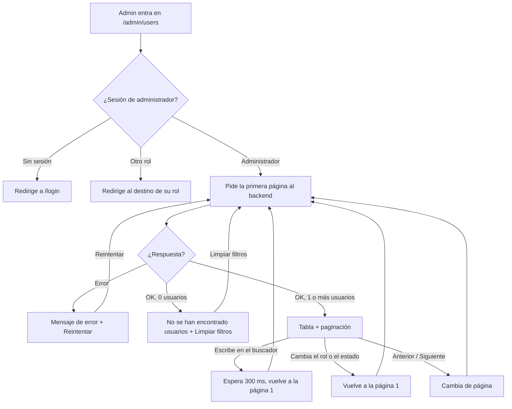
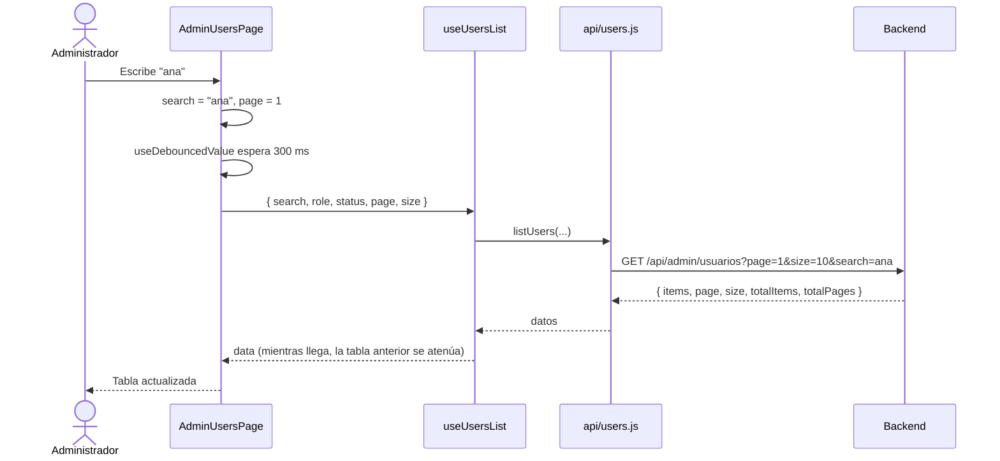

# HU19 · Listar y buscar usuarios (Frontend)

Documento para entender el listado de usuarios del administrador: qué muestra, cómo fluye la información, qué hace cada componente, qué contrato espera del backend y cómo probarlo.

- **Fecha:** 8 de octubre de 2026
- **HU:** HU19 · Listar y buscar usuarios (2 puntos)
- **Tasks:** AB#63 (tabla con buscador, filtros y paginación) y AB#64 (tests de la tabla de usuarios)
- **Rama:** `feature/US19-T63-T64-tabla-usuarios-admin`
- **Metodología:** TDD, ciclo a ciclo: cada comportamiento tiene un commit `test(front)` en rojo (AB#64) antes de su `feat(front)` en verde (AB#63)
- **Depende de:** `docs/hu2-login.md` (sesión y rutas protegidas), `docs/hu18-panel-admin.md` (zona de administración), `docs/hu32-listado-productos.md` (componentes reutilizados) y `docs/mocks-msw.md` (mocks)
- **Ampliado por la HU24** (`docs/hu24-activar-usuario.md`): los listados de clientes y administradores reutilizan este. Para ello, `UsersFilters` y `UsersTable` admiten opciones nuevas (todas opcionales), `listUsers` admite `searchBy`, `sort` y `order`, y el mock permite activar cuentas. Esta pantalla no cambia. Las partes afectadas de este documento están actualizadas.

---

## 1. Resumen

El administrador ve en `/admin/users` una tabla con todos los usuarios, paginada de 10 en 10, con búsqueda por nombre o email y filtros por rol y estado.

| Criterio de aceptación | Cómo se cumple |
|---|---|
| Se puede buscar por nombre o email | `UsersFilters`: buscador con retardo de 300 ms (sin botón). El servidor busca en nombre, apellidos y email. |
| Filtrar por rol y estado | Dos desplegables (`Select`) con "Todos los roles" / "Todos los estados". Se aplican al instante y se pueden combinar con la búsqueda. |
| El listado está paginado | `Pagination` + parámetros `page` y `size`. La paginación y el filtrado los hace el **servidor**. |

Columnas: nombre completo, email, rol, estado (etiqueta de color) y fecha de alta (`dd/mm/aaaa`).

> Ocultar o mostrar pantallas es **experiencia de usuario**. El backend debe responder 401 sin sesión y 403 si quien consulta no es administrador.

---

## 2. Flujo

### Flujo de la pantalla



### Flujo de datos



---

## 3. Componentes y archivos

Todas las rutas son relativas a `frontend/src/`.

### Página y ruta

| Archivo | Qué hace |
|---|---|
| `pages/AdminUsersPage.jsx` | Orquesta la pantalla. Guarda el estado de los filtros (`search`, `role`, `status`, `page`), decide qué mostrar (cargando, error, sin resultados o tabla) y vuelve a la página 1 cuando cambia un filtro. |
| `routes/paths.js` / `routes/AppRoutes.jsx` | Nueva ruta `ADMIN_USERS` (`/admin/users`), dentro del grupo protegido de administrador. |

### Funcionalidad del administrador (`features/admin/`)

| Archivo | Qué hace |
|---|---|
| `UsersTable.jsx` | Tabla con nombre, email, rol, estado y fecha de alta. El estado va en una etiqueta de color (`Badge`): Activo en verde, Pendiente en amarillo, Bloqueado en rojo y Desactivado en gris. Mientras llega otra página se atenúa y marca `aria-busy`. Se desplaza en horizontal en pantallas estrechas. |
| `UsersFilters.jsx` | Buscador "Buscar por nombre o email" y desplegables "Rol" y "Estado". No guarda estado: lo recibe de la página. Los dos desplegables comparten un componente interno (`FilterSelect`). |
| `useUsersList.js` | Hook que pide el listado cuando cambian los filtros. Se apoya en el hook común `useApiQuery`, que descarta las respuestas atrasadas y expone `data`, `failed`, `refreshing` y `retry`, igual que `useSellerProducts` (HU32). |
| `usersConfig.js` | Constantes: `USERS_PAGE_SIZE` (10), los estados de usuario y las etiquetas legibles de roles y estados. |

### Reutilizado de otras HU

| Archivo | De dónde | Para qué |
|---|---|---|
| `components/Pagination.jsx` | HU32 | Anterior / Siguiente, "Página X de Y" y "Mostrando A–B de N usuarios". |
| `components/EmptyState.jsx` | HU32 | Estado "No se han encontrado usuarios". |
| `hooks/useDebouncedValue.js` | HU32 (movido a `hooks/` en la HU26) | Retraso de 300 ms del buscador. |
| `hooks/useApiQuery.js` | HU26 | Petición con descarte de respuestas atrasadas, reintento y estado `refreshing`. |

### API y mocks

| Archivo | Qué hace |
|---|---|
| `api/users.js` | `listUsers({ search, role, status, page, size })`. Construye la consulta con `URLSearchParams` y omite los filtros vacíos y la búsqueda formada solo por espacios. |
| `mocks/usersHandlers.js` | Simula `GET /api/admin/usuarios`: 401 sin sesión, 403 si no es administrador, búsqueda sin distinguir mayúsculas ni acentos, filtros y paginación. |
| `mocks/handlers.js` | Registra el nuevo handler. |

---

## 4. Estados de la pantalla

| Estado | Cuándo | Qué se ve |
|---|---|---|
| Cargando | Primera carga o reintento | Indicador "Cargando usuarios…". |
| Error | La petición falla | Mensaje fijo "No se ha podido cargar el listado de usuarios. Inténtalo de nuevo." y botón **Reintentar**. Nunca se muestra el error técnico. |
| Sin resultados | 0 usuarios | "No se han encontrado usuarios" con **Limpiar filtros**. Los filtros siguen visibles. |
| Con usuarios | 1 o más | Filtros, tabla y paginación (si hay más de una página). |
| Actualizando | Cambio de página o de filtro con datos en pantalla | La tabla anterior se atenúa (55 %) con `aria-busy="true"` en lugar de vaciarse. |

Los filtros están siempre visibles, a diferencia del listado de productos, porque siempre habrá al menos un usuario (el propio administrador). Las transiciones se desactivan si el sistema tiene activado "reducir movimiento".

---

## 5. Contrato esperado del backend

La ruta y el formato los ha propuesto el frontend, alineados con el listado de productos de la HU32. **Hay que confirmarlos con quien desarrolla el backend de la HU19 (AB#61/62).** Si cambian, solo hay que tocar `api/users.js`, `usersConfig.js` y el mock. La HU24 añadió los parámetros opcionales `searchBy`, `sort` y `order` y el endpoint para activar una cuenta; se describen en su documento.

`GET /api/admin/usuarios?page=1&size=10&search=ana&role=VENDEDOR&status=PENDIENTE`

| Parámetro | Obligatorio | Significado |
|---|---|---|
| `page` | Sí | Página, empezando en 1 |
| `size` | Sí | Elementos por página (el frontend envía 10) |
| `search` | No | Texto contenido en nombre, apellidos o email, sin distinguir mayúsculas |
| `role` | No | `ADMINISTRADOR`, `VENDEDOR` o `CLIENTE` |
| `status` | No | `PENDIENTE`, `ACTIVO`, `BLOQUEADO` o `DESACTIVADO` |

Respuesta 200:

```json
{
  "items": [
    {
      "id": "usr-2",
      "nombre": "Mariana",
      "apellidos": "Ruiz Pascual",
      "email": "mariana.ruiz@esibuy.test",
      "rol": "VENDEDOR",
      "estado": "PENDIENTE",
      "fechaAlta": "2026-10-01T10:00:00"
    }
  ],
  "page": 1,
  "size": 10,
  "totalItems": 25,
  "totalPages": 3
}
```

| Estado | Significado para el frontend |
|---|---|
| 401 / 403 / 5xx | Mensaje de error con **Reintentar** |

- Los usuarios llegan ordenados por fecha de alta, del más reciente al más antiguo.
- `email` llega como texto y **nunca** se envía `contrasenaHash` (DTO en el borde, como pide el CLAUDE.md).
- `totalPages` es 0 cuando no hay resultados.

### Diferencias detectadas con el backend actual

Al integrar `develop` (octubre de 2026) el `Usuario` del dominio (AB#214) no encaja del todo con este contrato. Está comunicado al desarrollador del backend de la HU19:

| Dato | Backend en `develop` | Lo que necesita la HU19 |
|---|---|---|
| Estado | Solo `boolean bloqueado` | 4 estados (también los piden HU1, HU23 y HU24) |
| Fecha de alta | No existe | `fechaAlta` |
| Apellidos | `nuevoCliente()` los deja a `null` | Obligatorios según los requisitos de la base de datos |
| Página | La rama de AB#61/62 parece empezar en 0 y no devuelve `totalPages` | Empieza en 1 y devuelve `totalPages` |

---

## 6. Datos de prueba y cómo verlo en el navegador

Con `npm run dev` (mocks activos): usuario `admin@esibuy.test`, contraseña `Mock-Clave-1!`, código de correo `654321` y código de Authenticator `123456`.

La sesión simulada se pierde al recargar la página y el panel de control aún no enlaza con el listado (las tarjetas de la HU18 no están conectadas). Para llegar sin recargar, desde el panel, en la consola del navegador:

```js
history.pushState({}, '', '/admin/users'); dispatchEvent(new PopStateEvent('popstate'))
```

El mock tiene 25 usuarios ficticios (3 páginas: 10, 10 y 5) de los tres roles y los cuatro estados. Desde la HU24, los clientes solo están activos o desactivados: los pendientes son solo vendedores.

Pruebas manuales sugeridas:

1. Recorrer las tres páginas.
2. Buscar `ana`: solo aparecen Ana López García y Mariana Ruiz Pascual.
3. Buscar `alvaro` (sin acento): encuentra a Álvaro Campos Serrano.
4. Filtrar por **Vendedor** (7 usuarios) y por **Pendiente** (2 usuarios); combinar **Administrador** + **Activo** (2 usuarios).
5. Ir a la página 2 y cambiar un filtro: vuelve a la página 1.
6. Buscar `zzz`: aparece "No se han encontrado usuarios"; pulsar **Limpiar filtros**.
7. Reducir la ventana a ancho móvil: la tabla se desplaza en horizontal sin romper la página.

### Tests automáticos

```bash
npx vitest run     # 208 tests (22 son de esta HU)
npm run lint
npm run build
```

| Archivo | Tests | Qué cubre |
|---|---|---|
| `api/users.test.js` | 5 | Parámetros de la petición (página, tamaño, búsqueda, rol, estado) y propagación del error |
| `features/admin/UsersTable.test.jsx` | 2 | Cabeceras y contenido legible de cada fila |
| `features/admin/UsersFilters.test.jsx` | 3 | Buscador y desplegables de rol y estado |
| `pages/AdminUsersPage.test.jsx` | 12 | La pantalla completa contra el mock: listado, búsqueda, filtros, paginación, vuelta a la página 1, sin resultados, error y reintento, tabla ocupada |

Cada test empieza por el ID de su caso de prueba (`HU19-CPnn`):

| Caso | Descripción |
|---|---|
| HU19-CP01 | Muestra nombre, email, rol, estado y fecha de alta de cada usuario |
| HU19-CP02 | Busca por nombre o email |
| HU19-CP03 | Filtra por rol |
| HU19-CP04 | Filtra por estado |
| HU19-CP05 | El listado está paginado de 10 en 10 |
| HU19-CP06 | Al cambiar la búsqueda o un filtro vuelve a la primera página |
| HU19-CP07 | Sin coincidencias muestra que no se han encontrado usuarios |
| HU19-CP08 | Si la API falla muestra un mensaje de error con reintento |

---

## 7. Decisiones y librerías

- **No se ha añadido ninguna librería nueva.** Fluent UI (`Table`, `Badge`, `SearchBox`, `Select`, `Field`, `Spinner`, `MessageBar`, `Button`), `@fluentui/react-icons` y `react-router-dom`.
- **Mismo contrato y mismos componentes que la HU32** (`Pagination`, `EmptyState`, `useDebouncedValue`), para que los listados del proyecto se comporten igual.
- **Estilo según `DESIGN.md`:** tabla en superficie blanca con borde suave, esquinas de 8 px y sombra ligera; estado con `Badge` de Fluent; fechas con cifras de ancho fijo.
- **Búsqueda con retardo y filtros al instante:** escribir genera muchas pulsaciones; elegir en un desplegable, solo una.
- **Tamaño de página en una constante** (`USERS_PAGE_SIZE`) para poder ampliarlo en el futuro.
- **Filtros en la página, no en la URL**, igual que en la HU32.

## 8. Limitaciones y trabajo pendiente

- Ninguna tarjeta del panel de administración (HU18) enlaza con `/admin/users`. Las de **Clientes** y **Administradores** llevan a sus propios listados (HU24 y HU21), que reutilizan este.
- En esta pantalla no hay ordenación por columnas ni acciones por fila (ver detalle, activar, desactivar). La ordenación y la ficha de cada usuario, con activar y desactivar, existen en los listados de clientes y administradores (HU24, HU23 y HU20).
- Los nombres de los estados y el contrato están pendientes de confirmar con el backend (sección 5).

---

## 9. Uso de IA generativa

Este documento y el trabajo técnico que describe se hicieron con ayuda de un asistente de IA generativa, como exige el enunciado.

- **Herramienta:** Claude (modelo de Anthropic), mediante Claude Code, con las skills `plan-task` (plan de la task) e `impeccable` (revisión de diseño contra `DESIGN.md`).
- **Qué generó la IA:** el plan de la task, los tests, la implementación (API, componentes, hook, página), los mocks y este documento.
- **Qué decidió el desarrollador:** la ruta de la API y de la página, el tamaño de página y su constante, el retardo de la búsqueda, los filtros al instante, la vuelta a la página 1, los casos de prueba, los nombres de tests y archivos, reutilizar la paginación y el contrato de la HU32, cómo reutilizar `useDebouncedValue`, extraer el hook `useUsersList` y el estado de tabla ocupada.
- **Cómo se comprobó:** **208 tests en verde** (22 de esta HU), ESLint sin errores y build de producción correcto. Los tests se escribieron antes que la implementación, en ciclos rojo-verde con commits separados. El desarrollador revisó la pantalla en el navegador con los mocks.
- **Qué NO se comprobó:** el flujo contra un backend real; el contrato de la sección 5 debe acordarse con el backend.
- **Revisión humana:** el código fue revisado, ejecutado y validado por el desarrollador antes de su integración. Documentado por: Daniel.
