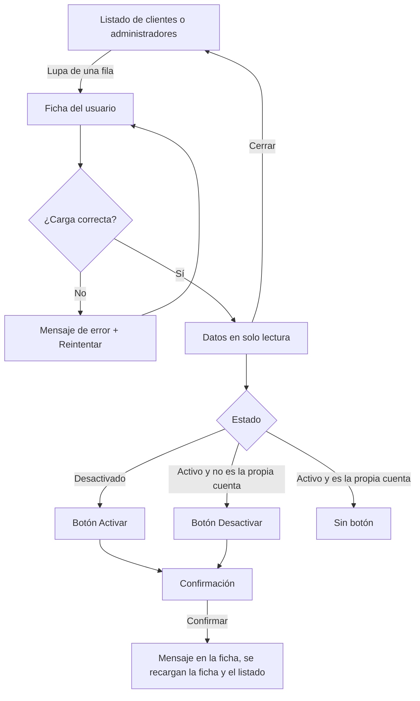

# HU20 · Consultar el detalle de un usuario (Frontend)

Documento para entender cómo el administrador consulta la ficha de un cliente o de un administrador, por qué esta HU completa lo que ya hizo la HU26 con los vendedores, qué hace cada parte del código, qué contrato espera del backend y cómo probarlo.

- **Fecha:** 9 de octubre de 2026
- **HU:** HU20 · Consultar el detalle de un usuario
- **Tasks:** AB#53 (vista de la ficha de usuario) y AB#211 (tests del detalle de usuario)
- **Rama:** `feature/US20-T53-T211-ficha-usuario`
- **Metodología:** sin TDD por decisión del equipo. Primero el código (commit `feat` con AB#53) y después los tests (commit `test` con AB#211).
- **Depende de:** `docs/hu26-supervision-vendedores.md` (ficha del vendedor), `docs/hu24-activar-usuario.md` y `docs/hu23-desactivar-usuario.md` (listados y cambio de estado) y `docs/mocks-msw.md` (mocks)

---

## 1. Resumen

El administrador pulsa la **lupa** de una fila de **Clientes** o de **Administradores** y se abre, por encima del listado, la **ficha** del usuario: sus datos en solo lectura, **sin la contraseña**, y el botón para **activar** o **desactivar** la cuenta.

### Solapamiento con la HU26

Las tareas de la HU26 (supervisión de vendedores) incluían ya la ficha de los **vendedores**, que es justo lo que pide esta HU para ese tipo de usuario. Por eso esta HU **completa la parte que faltaba: clientes y administradores**, y lo hace igual que en los vendedores, para que los tres listados funcionen de la misma forma.

| Usuarios | Ficha | Hecha en |
|---|---|---|
| Vendedores | Lupa → diálogo con pestañas Datos, Productos y Pedidos | HU26 |
| Clientes | Lupa → diálogo con sus datos | **HU20** |
| Administradores | Lupa → diálogo con sus datos | **HU20** |

### Cambios en lo hecho por la HU23 y la HU24

Para dejarlo igual que en los vendedores, **los botones Activar y Desactivar han pasado de la fila a la ficha**. En las filas de clientes y administradores solo queda la lupa. El comportamiento no cambia: misma confirmación, mismos mensajes y mismas reglas (no desactivarse a sí mismo y no desactivar al último administrador activo). Los documentos de la HU23 y la HU24 están actualizados.

### Qué muestra la ficha

| Clientes | Administradores |
|---|---|
| Nombre, apellidos y email | Nombre, apellidos y email |
| DNI, teléfono y fecha de nacimiento | Sede y fecha de incorporación |
| Tipo de cliente (Estándar o Premium) | — |
| Imagen de perfil | Imagen de perfil |
| Estado y fecha de alta | Estado y fecha de alta |

Los campos son de solo lectura y se ven más oscuros, con el aviso "Modo solo lectura", igual que en la ficha del vendedor. Debajo está el botón de estado:

| Estado | Botón |
|---|---|
| Desactivado | **Activar** |
| Activo | **Desactivar** (salvo en la ficha del propio administrador) |

> **Fuera de esta HU:** editar los datos es la HU22 y eliminar usuarios no tiene HU en este sprint, así que la ficha no tiene esos botones.

---

## 2. Flujo



---

## 3. Componentes y archivos

Todas las rutas son relativas a `frontend/src/`.

| Archivo | Qué hace |
|---|---|
| `features/admin/UserDetailDialog.jsx` | La ficha: pide los datos, muestra los campos según el rol, el aviso de solo lectura, los errores con **Reintentar** y el botón de estado con sus mensajes. |
| `features/admin/ReadOnlyFields.jsx` | Rejilla de campos de solo lectura. Se sacó de `SellerDataForm.jsx` (HU26), que ahora la usa sin cambiar su aspecto. |
| `features/admin/RoleUsersList.jsx` (HU24) | La fila muestra la lupa en lugar de los botones de estado y abre la ficha. Cuando la ficha cambia un estado, el listado se recarga. |
| `features/admin/UsersTable.jsx` (HU19) | La columna opcional se llama ahora **Información**, como en el listado de vendedores. |
| `features/admin/UserStatusButton.jsx` y `StatusConfirmDialog.jsx` (HU23/HU24) | Se reutilizan dentro de la ficha sin cambios. |
| `api/users.js` | Nueva `getUser(userId)`. |
| `mocks/usersHandlers.js` | Nuevo `GET /api/admin/usuarios/{id}` con los datos completos de cada usuario. Son **ficticios** y se calculan a partir del identificador, para que cada usuario tenga siempre los mismos (el DNI lleva su letra correcta). El listado no los incluye. |

---

## 4. Seguridad

- **La contraseña no se muestra** ni viaja en la respuesta de la ficha (el mock no la tiene).
- **Datos personales solo en la ficha:** el DNI, el teléfono o la fecha de nacimiento no salen en el listado, solo al abrir la ficha de un usuario concreto.
- **Solo el administrador** accede a los listados y a la ficha (rutas protegidas), y el mock responde 401 sin sesión y 403 con otro rol. En el backend, la zona `/api/admin/**` ya exige el rol ADMINISTRADOR (HU18).
- **Las reglas de activar y desactivar** son las de la HU23 y la HU24.

---

## 5. Contrato esperado del backend

**El frontend se ha desarrollado y probado con mocks (MSW).** Las rutas y formatos de esta sección los ha definido el frontend para poder comprobar las pantallas. Si al unirlo con el backend hay diferencias, se ajustará el frontend.

`GET /api/admin/usuarios/{id}`

Cliente:

```json
{
  "id": "usr-4",
  "nombre": "Lucía",
  "apellidos": "Torres Vega",
  "email": "lucia.torres@esibuy.test",
  "rol": "CLIENTE",
  "estado": "DESACTIVADO",
  "fechaAlta": "2026-09-28T17:45:00",
  "dni": "10005492D",
  "telefono": "620031676",
  "fechaNacimiento": "1979-05-14",
  "tipoCliente": "ESTANDAR",
  "avatar": "avatar2"
}
```

Administrador: los mismos campos comunes más `sede`, `fechaIncorporacion` y `avatar`.

| Respuesta | Significado para el frontend |
|---|---|
| 200 | Se muestra la ficha |
| 401 / 403 / 404 / 5xx | Mensaje de error con **Reintentar** |

- `tipoCliente` usa los valores del backend (`ESTANDAR` o `PREMIUM`); el frontend los muestra como "Estándar" y "Premium".
- `avatar` (o `imagenPerfil`, según se acuerde con el registro) es el identificador del avatar elegido; si falta, se muestra "Sin elegir".
- Activar y desactivar desde la ficha usan el endpoint de la HU23 y la HU24.

---

## 6. Datos de prueba y cómo verlo en el navegador

Con `npm run dev` (mocks activos): `admin@esibuy.test`, contraseña `Mock-Clave-1!`, código de correo `654321` y código de Authenticator `123456`.

Pruebas manuales sugeridas:

1. **Panel → Clientes**, pulsar la lupa de **Lucía Torres Vega**: aparecen sus datos (DNI, teléfono, tipo de cliente…) y el botón **Activar**.
2. Activarla desde la ficha: pide confirmación, sale el mensaje en la ficha y, al cerrarla, la fila aparece como **Activo**.
3. **Panel → Administradores**, abrir la ficha de **Ada Admin** (la sesión): no tiene **Desactivar**.
4. Abrir la ficha de **Diego Delgado Iglesias**: muestra sede y fecha de incorporación, y el botón **Activar**.
5. Comprobar que en ninguna ficha aparece la contraseña y que los campos no se pueden editar.

Los cambios se olvidan al recargar la página.

### Tests automáticos

```bash
npx vitest run     # 405 tests (23 nuevos de esta HU)
npm run lint
npm run build
```

| Archivo | Tests de esta HU | Qué cubre |
|---|---|---|
| `features/admin/UserDetailDialog.test.jsx` | 13 | Datos de un cliente y de un administrador, sin contraseña, solo lectura y aviso, cerrar, error con reintento, botón según el estado, sin Desactivar en la propia ficha, activar, desactivar, último administrador y error genérico |
| `features/admin/RoleUsersList.test.jsx` | 4 | Lupa en cada fila (y ya no los botones de estado), abrir la ficha del usuario pulsado, la ficha recibe el usuario de la sesión y el listado se actualiza al cambiar el estado |
| `pages/AdminAdminsPage.test.jsx` | 2 | Ficha de la sesión sin Desactivar y activar un administrador desde su ficha |
| `features/admin/ReadOnlyFields.test.jsx` | 2 | Etiquetas y valores, y que no se pueden editar |
| `api/users.test.js` | 2 | `getUser`: ruta y error 404 |

Los tests de activar y desactivar que la HU23 y la HU24 hacían sobre los botones de la fila se han sustituido por los de la ficha. También se ajustó el de la columna de `UsersTable.test.jsx` (ahora se llama **Información**).

---

## 7. Decisiones

- **Igual que la ficha del vendedor:** lupa en la fila, diálogo por encima del listado, aviso de solo lectura, campos oscuros y botón de estado en la ficha.
- **Activar y desactivar solo en la ficha,** para que los tres listados funcionen igual. Se han modificado para ello archivos de la HU23 y la HU24.
- **Sin pestañas:** los clientes y los administradores no tienen productos ni pedidos que consultar en este sprint (la ficha del vendedor sí los tiene).
- **Reutilización:** la rejilla de solo lectura se comparte con la ficha del vendedor, y el botón y la confirmación son los de la HU23 y la HU24.

## 8. Limitaciones y trabajo pendiente

- **Editar los datos** desde la ficha es la HU22; **eliminar** usuarios no tiene HU en este sprint.
- **La imagen de perfil** se muestra como texto ("Avatar 2"), no como el dibujo del avatar.
- **La pantalla general de Usuarios** (`/admin/users`, HU19) no tiene lupa ni enlace desde el panel; se decidirá más adelante si se unifica con estos listados.
- **El título del diálogo** es genérico ("Información del usuario") para clientes y administradores.

---

## 9. Uso de IA generativa

Este documento y el trabajo técnico que describe se hicieron con ayuda de un asistente de IA generativa, como exige el enunciado.

- **Herramienta:** Claude (modelo de Anthropic), mediante Claude Code.
- **Qué generó la IA:** la ficha, la rejilla compartida, el cambio de los botones de estado de la fila a la ficha, el endpoint del mock con sus datos de prueba, los tests y este documento. También hizo los commits, a petición del equipo.
- **Qué hizo el equipo:**
  - aclaró el solapamiento con la HU26 y que esta HU completa clientes y administradores;
  - decidió que la ficha funcione igual que la del vendedor, con activar y desactivar dentro, y que no tenga editar ni eliminar;
  - decidió no tocar la pantalla general de Usuarios;
  - revisó cada paso y comprobó las pantallas en el navegador con los mocks.
- **Cómo se comprobó:** tests (405 en la suite), ESLint sin errores y build de producción correcto.
- **Qué NO se comprobó:** el flujo contra un backend real.
- **Revisión humana:** el código fue revisado, ejecutado y validado por el equipo antes de su integración. Revisado por: Alejandro.
