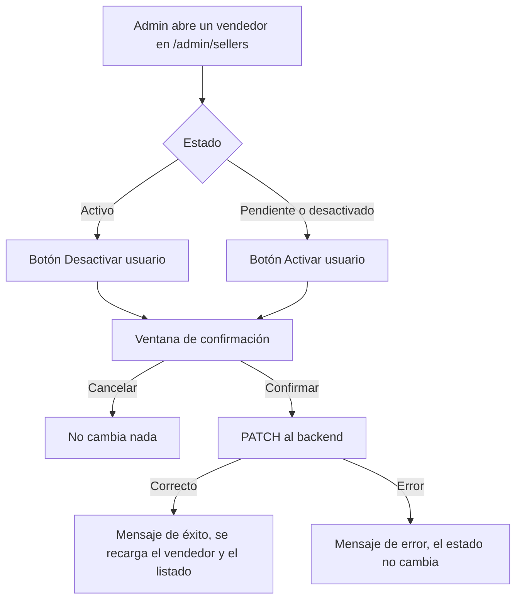
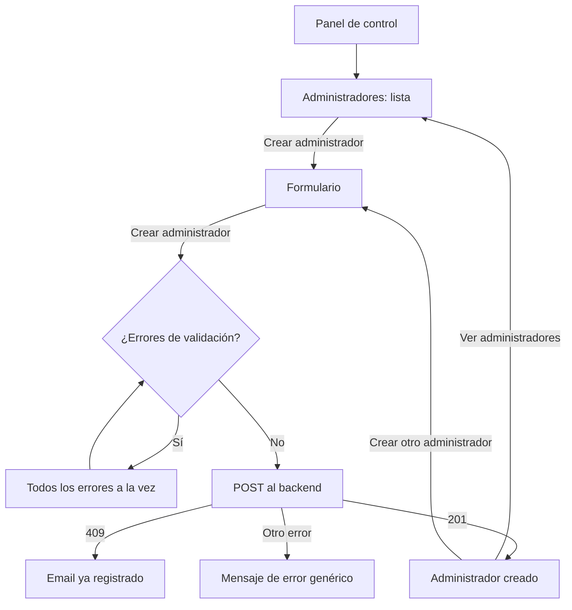

# HU21 · Alta de administradores y activación de vendedores (Frontend)

Documento para entender qué cubre la HU21 en el frontend, qué hace cada parte del código, qué contrato espera del backend y cómo probarlo.

- **Fecha:** 8 de octubre de 2026
- **HU:** HU21 · Crear usuario (incluido administrador)
- **Tasks:** AB#50 (formulario de creación) y AB#51 (tests del formulario)
- **Rama:** `feature/US21-T50-T51-alta-admin-y-vendedores`
- **Metodología:** sin TDD por decisión del equipo. Primero el código (commits `feat`, `refactor` y `fix` con AB#50) y después los tests (commits `test` con AB#51).
- **Depende de:** `docs/hu18-panel-admin.md` (panel), `docs/hu19-listado-usuarios.md` (listado de usuarios), `docs/hu26-supervision-vendedores.md` (supervisión de vendedores), `docs/hu1-registro.md` (password y avatares), `docs/mocks-msw.md` (mocks) y `docs/sonar-incidencias.md` (convención de `propTypes`)
- **Ampliado por la HU24** (`docs/hu24-activar-usuario.md`): la lista de administradores tiene ahora búsqueda por nombre, filtro por estado, ordenación y el botón **Activar**, y la ventana de confirmación es un componente compartido. Las partes afectadas de este documento están actualizadas.

---

## 1. Resumen

El título de la HU ("crear usuario") puede confundir. El equipo confirmó que la HU21 consiste en dos cosas:

- **A) Activar y desactivar vendedores.** El administrador acepta a los vendedores que se registran (quedan **pendientes**) para que puedan usar la plataforma, y puede desactivarlos o volver a activarlos.
- **B) Crear administradores.** Un administrador da de alta a una persona nueva como administrador, desde una lista con todos los administradores.

> **Relación con la HU23 (desactivar usuario) y la HU24 (activar usuario).** La parte A adelanta trabajo de esas dos historias, solo para **vendedores** y solo en el frontend: el botón, la confirmación y la llamada al backend. Lo que esas historias piden además (que un usuario desactivado no pueda iniciar sesión, invalidar su sesión, que un admin no pueda desactivarse a sí mismo, etc.) sigue pendiente. Ver la sección 8.

### Parte A: activar y desactivar vendedores

Se aprovecha la pantalla de la HU26 (**Panel de control → Vendedores**, `/admin/sellers`). Al abrir un vendedor, el botón del diálogo depende de su estado:

| Estado del vendedor | Botón | Qué hace al confirmar |
|---|---|---|
| Pendiente | **Activar usuario** | Lo da de alta: pasa a activo |
| Desactivado | **Activar usuario** | Pasa a activo |
| Activo | **Desactivar usuario** | Pasa a desactivado |

Antes de cambiar nada aparece una **ventana de confirmación** ("¿Seguro que quieres activar a Hogar Hugo?"). Tras confirmar, el diálogo muestra un mensaje de éxito o de error y el listado de vendedores se actualiza.

### Parte B: administradores

**Panel de control → Administradores** (`/admin/admins`) muestra la **lista de administradores**, con el botón **Crear administrador**, que abre el formulario (`/admin/admins/new`).

| Campo | Reglas |
|---|---|
| Nombre | Obligatorio. Máximo 30 caracteres |
| Apellidos | Obligatorio. Máximo 30 caracteres |
| Email | Obligatorio. Formato válido, máximo 100 caracteres. Único |
| Sede | Opcional. Máximo 30 caracteres. Existe aunque todavía no se use para nada |
| Fecha de incorporación | La de hoy, automática y no editable. No se envía: la pone el backend |
| Password | Obligatorio. Mínimo 8 caracteres, con mayúscula, minúscula, número y símbolo. Máximo 64. Con botón para mostrarlo |
| Repetir password | Obligatorio. Igual que el password |
| Imagen de perfil | Opcional. Uno de los tres avatares del registro |

El password lo escribe el administrador que crea la cuenta (opción "a" de `Contexto_frontend.md`, sección 6.4), y la cuenta queda **activa**. Como en el registro, al pulsar **Crear administrador** se muestran todos los errores a la vez.

---

## 2. Flujo

### Activar o desactivar un vendedor



### Crear un administrador



---

## 3. Componentes y archivos

Todas las rutas son relativas a `frontend/src/`.

### Páginas y rutas

| Archivo | Qué hace |
|---|---|
| `pages/AdminAdminsPage.jsx` | Lista de administradores con paginación, **Crear administrador** y **Volver al panel**. Reutiliza el listado de usuarios de la HU19 pidiendo solo el rol `ADMINISTRADOR`. |
| `pages/AdminNewAdminPage.jsx` | Formulario de alta: validación, envío, confirmación y "crear otro". |
| `pages/AdminPage.jsx` | La tarjeta **Administradores** lleva ahora a la lista. |
| `routes/paths.js` / `routes/AppRoutes.jsx` | Rutas `ADMIN_ADMINS` (`/admin/admins`) y `ADMIN_NEW_ADMIN` (`/admin/admins/new`), solo para administradores. |

### Activar y desactivar (`features/admin/`)

| Archivo | Qué hace |
|---|---|
| `SellerDetailDialog.jsx` | El botón del diálogo de la HU26 ya funciona. Añade la ventana de confirmación (desde la HU24 es el componente compartido `StatusConfirmDialog.jsx`), los textos de cada acción y la prop `onStatusChange` para avisar al listado. |
| `pages/AdminSellersPage.jsx` | Recarga el listado cuando cambia el estado de un vendedor. |

### Piezas compartidas con el registro (`features/account/`)

Se sacaron del registro (HU1) para que el registro y el alta de administradores usen el mismo código.

| Archivo | Qué hace |
|---|---|
| `accountRules.js` | Requisitos del password, validación del email y comprobación de que los dos passwords coinciden. |
| `PasswordField.jsx` | `PasswordField` (campo con botón para mostrar u ocultar) y `PasswordRequirements` (lista de requisitos con tick verde). |
| `AvatarSelector.jsx` | Los tres avatares con iconos de animales. |

`pages/Register.jsx` usa ahora estas piezas, sin cambiar su comportamiento.

### API y mocks

| Archivo | Qué hace |
|---|---|
| `api/admins.js` | `createAdmin(datos)`. |
| `api/adminSellers.js` | Añade `updateAdminSellerStatus(sellerId, estado)`. |
| `mocks/adminsHandlers.js` | Simula el alta: comprueba que el email no exista, responde 409 si existe y añade el nuevo administrador al listado de usuarios. Nunca guarda el password. |
| `mocks/adminSellersHandlers.js` | Simula el cambio de estado de un vendedor y lo recuerda durante la sesión. |
| `mocks/usersHandlers.js` | Su lista puede crecer, para que los administradores creados aparezcan en el listado. |
| `test/setup.js` | Reinicia el estado de estos mocks después de cada test. |

---

## 4. Seguridad

- **Solo el administrador** accede a estas pantallas (rutas protegidas) y los mocks responden 401 sin sesión y 403 con otro rol. La barrera real tiene que ponerla el backend.
- **Confirmación obligatoria** antes de activar o desactivar a un vendedor.
- **Misma política de password que el registro**, con los requisitos visibles desde el principio.
- **El password no se guarda** ni en el navegador ni en el mock, y la repetición del password **no se envía** al backend.
- **Los errores del servidor se muestran con un mensaje genérico,** sin detalles internos.

---

## 5. Contrato esperado del backend

**El frontend se ha desarrollado y probado con mocks (MSW).** Las rutas y formatos de esta sección los ha definido el frontend para poder comprobar las pantallas. Si al unirlo con el backend hay diferencias, se ajustará el frontend.

### Cambiar el estado de un vendedor

`PATCH /api/admin/sellers/{id}/status`

```json
{ "estado": "ACTIVO" }
```

| Respuesta | Significado para el frontend |
|---|---|
| 200 + datos del vendedor | Estado cambiado |
| 400 | Estado no admitido (solo `ACTIVO` o `DESACTIVADO`) |
| 401 / 403 / 404 / 5xx | Mensaje de error; el estado no cambia |

### Crear un administrador

`POST /api/admin/admins`

```json
{
  "nombre": "Nora",
  "apellidos": "Díaz Ruiz",
  "email": "nora@esibuy.test",
  "sede": "Ciudad Real",
  "avatar": "avatar2",
  "password": "Password123!"
}
```

| Respuesta | Significado para el frontend |
|---|---|
| 201 | Administrador creado |
| 409 + `{ "code": "EMAIL_ALREADY_REGISTERED" }` | "Este email ya está registrado" |
| 401 / 403 / 5xx | Mensaje de error genérico |

### Listar los administradores

Se usa el endpoint de la HU19, `GET /api/admin/usuarios`, con `role=ADMINISTRADOR`.

---

## 6. Datos de prueba y cómo verlo en el navegador

Con `npm run dev` (mocks activos): `admin@esibuy.test`, contraseña `Mock-Clave-1!`, código de correo `654321` y código de Authenticator `123456`.

| Prueba | Resultado |
|---|---|
| Vendedores → filtrar por **Pendiente** → abrir `Hogar Hugo` → **Activar usuario** → confirmar | Pasa a activo y el listado se actualiza |
| Abrir un vendedor activo → **Desactivar usuario** → **Cancelar** | No cambia nada |
| Administradores | Lista con 3 administradores |
| Crear administrador con un email nuevo → **Ver administradores** | El nuevo aparece el primero de la lista |
| Crear administrador con el email `cliente@esibuy.test` | "Este email ya está registrado" |

Los cambios se olvidan al recargar la página.

### Tests automáticos

```bash
npx vitest run     # 344 tests (61 son de esta HU)
npm run lint
npm run build
```

| Archivo | Tests de esta HU | Qué cubre |
|---|---|---|
| `features/admin/SellerDetailDialog.test.jsx` | 7 | Botón según el estado, confirmación, cancelar, activar un pendiente, activar un desactivado, desactivar y error del servidor |
| `pages/AdminNewAdminPage.test.jsx` | 19 | Campos, obligatorios, fecha, longitudes, validaciones, alta, datos enviados, email repetido, error del servidor, crear otro, navegación y acceso por rol |
| `pages/AdminAdminsPage.test.jsx` | 7 | Solo administradores, filtro por rol, botón de crear, volver al panel, error con reintento y acceso por rol |
| `pages/AdminPage.test.jsx` | 1 | La tarjeta **Administradores** abre la lista |
| `features/account/accountRules.test.js` | 11 | Requisitos del password (con acentos y ñ), formato del email y comparación de passwords |
| `features/account/PasswordField.test.jsx` | 7 | Campo de password y lista de requisitos |
| `features/account/AvatarSelector.test.jsx` | 4 | Avatares, selección y aviso del cambio |
| `api/admins.test.js` | 2 | Petición de alta y error 409 |
| `api/adminSellers.test.js` | 3 | Petición de cambio de estado, ruta codificada y error |

---

## 7. Decisiones

- **Activar y desactivar se hace en la pantalla de la HU26,** reutilizando su diálogo en lugar de crear otra pantalla, como pidió el equipo.
- **Un vendedor pendiente muestra "Activar usuario":** es la forma de aceptarlo. Antes mostraba "Desactivar usuario".
- **La lista de administradores reutiliza el listado de usuarios de la HU19** filtrado por rol, en lugar de un endpoint propio.
- **Password escrito por el administrador** (opción "a"), por ser la más simple por ahora.
- **Piezas compartidas con el registro** (`features/account/`), para no duplicar código.
- **`propTypes` en todos los componentes nuevos,** según la convención del equipo tras la corrección de incidencias de Sonar.
- No se añade ninguna librería nueva (`prop-types` la añadió el equipo en `develop`).

## 8. Limitaciones y trabajo pendiente

- **HU23 y HU24:** ya están hechas en el frontend: activar y desactivar clientes y administradores, el listado de clientes y la búsqueda, el filtro y la ordenación de la lista de administradores, y las reglas de no desactivarse a sí mismo ni al último administrador activo. Queda invalidar la sesión de un usuario desactivado (ver `docs/hu23-desactivar-usuario.md`).
- **No se puede editar a un administrador** desde su lista.
- **Test intermitente conocido:** `sellerDetailDialog_alConfirmarActivarUnVendedorPendiente_loDaDeAlta` falla de vez en cuando con toda la suite en marcha, por cómo Fluent oculta el diálogo a la accesibilidad mientras se abre o se cierra la confirmación. Ejecutado solo, siempre pasa. Si falla en el CI, basta con relanzarlo.

---

## 9. Uso de IA generativa

Este documento y el trabajo técnico que describe se hicieron con ayuda de un asistente de IA generativa, como exige el enunciado.

- **Herramienta:** Claude (modelo de Anthropic), mediante Claude Code.
- **Qué generó la IA:** el código de las dos partes, las piezas compartidas con el registro, los mocks, los tests, la resolución de los merges con `develop` y este documento. También hizo los commits, a petición del equipo.
- **Qué hizo el equipo:**
  - aclaró qué cubre realmente la HU21 (consultándolo con los compañeros);
  - decidió reutilizar la pantalla de la HU26, la confirmación, la opción del password y la lista de administradores con su botón de crear;
  - revisó cada paso y comprobó las pantallas en el navegador con los mocks.
- **Cómo se comprobó:** tests (344 en la suite), ESLint sin errores y build de producción correcto.
- **Qué NO se comprobó:** el flujo contra un backend real.
- **Revisión humana:** el código fue revisado, ejecutado y validado por el equipo antes de su integración. Revisado por: Alejandro.
