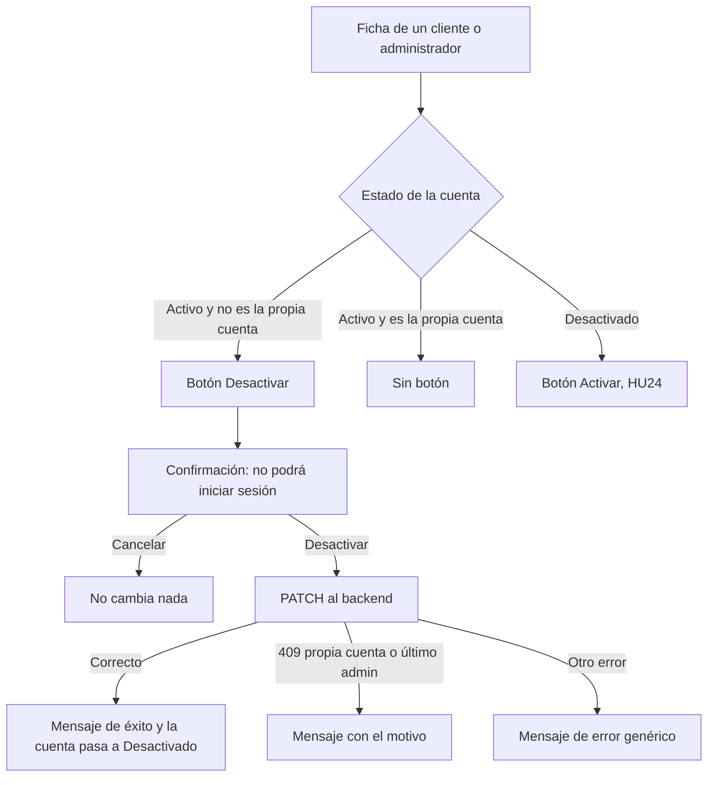

# HU23 · Desactivar usuario (Frontend)

Documento para entender cómo el administrador desactiva cuentas, qué reglas se aplican, qué hace cada parte del código, qué contrato espera del backend y cómo probarlo.

- **Fecha:** 8 de octubre de 2026
- **HU:** HU23 · Desactivar usuario
- **Tasks:** AB#40 (acción Desactivar con confirmación) y AB#41 (tests de la acción Desactivar)
- **Rama:** `feature/US23-T40-T41-desactivar-usuario`
- **Metodología:** sin TDD por decisión del equipo. Primero el código (commit `feat` con AB#40) y después los tests (commit `test` con AB#41).
- **Depende de:** `docs/hu24-activar-usuario.md` (listados de clientes y administradores y botón de la fila), `docs/hu21-alta-admin-y-vendedores.md` (desactivar vendedores), `docs/hu2-login.md` (mensaje de cuenta desactivada) y `docs/mocks-msw.md` (mocks)
- **Actualizado por la HU20** (`docs/hu20-ficha-usuario.md`): los botones **Activar** y **Desactivar** están ahora en la **ficha** del usuario, que se abre con la lupa de cada fila, como en los vendedores. Las partes afectadas de este documento están actualizadas y sus tests sobre la fila se sustituyeron por los de la ficha.

---

## 1. Resumen

El administrador desactiva las cuentas **activas** de cualquier tipo de usuario. Antes de desactivar se pide confirmación, avisando de que el usuario ya no podrá iniciar sesión.

| Usuarios | Dónde se desactivan |
|---|---|
| Vendedores | **Vendedores** → lupa → diálogo → **Desactivar usuario** (hecho en la HU21) |
| Clientes | **Clientes** → lupa → ficha → **Desactivar** (en esta HU estaba en la fila; la HU20 lo pasó a la ficha) |
| Administradores | **Administradores** → lupa → ficha → **Desactivar** (ídem) |

En la ficha de cada cliente o administrador (en la fila hasta la HU20) aparece el botón que le corresponde:

| Estado de la cuenta | Botón |
|---|---|
| Activo | **Desactivar** (salvo en la ficha del propio administrador) |
| Desactivado | **Activar** (HU24) |

### Criterios de la HU y cómo se cumplen

| Criterio (`Contexto_frontend.md`) | Cómo se cumple en el frontend |
|---|---|
| Requiere confirmación | Ventana "Desactivar usuario" con **Cancelar** y **Desactivar** |
| Un administrador no puede desactivarse a sí mismo | En su propia ficha no aparece **Desactivar**. Si la petición llegara igualmente, el backend responde con un error y se muestra *"No puedes desactivar tu propia cuenta."* |
| No se puede desactivar al último administrador activo | Lo comprueba el backend; el frontend muestra *"No se puede desactivar al último administrador activo."* |
| El usuario desactivado no puede iniciar sesión (mensaje específico) | El login ya muestra *"Esta cuenta está desactivada. Contacta con un administrador."* (HU2) cuando el backend responde `403` con `ACCOUNT_DISABLED` |
| Su sesión se invalida | Es tarea del backend. En el frontend queda pendiente (sección 8) |

> **Sobre el "último administrador activo".** Desde la pantalla siempre queda al menos un administrador activo, el que la está usando, porque no puede desactivarse a sí mismo. La regla protege de casos que no se ven en la pantalla: por ejemplo, dos administradores que se desactivan el uno al otro a la vez, o peticiones que llegan al backend sin pasar por la interfaz. Por eso la comprueba el backend y el frontend se limita a mostrar el motivo.

---

## 2. Flujo



---

## 3. Componentes y archivos

Todas las rutas son relativas a `frontend/src/`.

| Archivo | Qué hace |
|---|---|
| `features/admin/UserStatusButton.jsx` | Botón que **activa o desactiva** (en la fila; desde la HU20, en la ficha) según la acción que recibe, siempre con confirmación. Sustituye a `ActivateUserButton.jsx` de la HU24, para no tener dos botones casi iguales. Su nombre accesible incluye el del usuario ("Desactivar a Carlos Moreno Gil"). |
| `features/admin/RoleUsersList.jsx` | Decidía qué botón llevaba cada fila (activar, desactivar o ninguno en la propia cuenta) y traducía los errores del backend a mensajes. Desde la HU20 esa lógica está en `UserDetailDialog.jsx` y la fila solo tiene la lupa. Recibe el usuario de la sesión en `currentUserId` y se lo pasa a la ficha. |
| `pages/AdminClientsPage.jsx` / `pages/AdminAdminsPage.jsx` | Pasan a la lista el usuario de la sesión, que obtienen con `useAuth`. |
| `features/admin/StatusConfirmDialog.jsx` | La misma ventana de confirmación de la HU21 y la HU24. |
| `api/users.js` | `updateUserStatus(userId, estado)`, que sirve para activar y para desactivar. Sustituye a `activateUser`. |
| `mocks/usersHandlers.js` | El cambio de estado admite `DESACTIVADO` y aplica las dos reglas. El administrador de la sesión del mock (**Ada Admin**, `admin@esibuy.test`) aparece en la lista en lugar de Carmen Hidalgo Rojas, para que se vea la regla de la propia cuenta. |

---

## 4. Seguridad

- **Confirmación obligatoria** antes de desactivar, avisando de la consecuencia (no podrá iniciar sesión).
- **Las reglas se aplican en el backend.** El frontend oculta el botón en la propia ficha por comodidad, pero el backend debe rechazar la petición igualmente.
- **Solo el administrador** accede a los listados (rutas protegidas), y el mock responde 401 sin sesión y 403 con otro rol.
- **Los errores se muestran sin detalles internos:** solo los dos motivos conocidos tienen un mensaje propio; el resto, uno genérico.

---

## 5. Contrato esperado del backend

**El frontend se ha desarrollado y probado con mocks (MSW).** Las rutas y formatos de esta sección los ha definido el frontend para poder comprobar las pantallas. Si al unirlo con el backend hay diferencias, se ajustará el frontend.

`PATCH /api/admin/usuarios/{id}/status` (el mismo endpoint que activar, HU24)

```json
{ "estado": "DESACTIVADO" }
```

| Respuesta | Significado para el frontend |
|---|---|
| 200 + datos del usuario | Cuenta desactivada |
| 409 + `{ "code": "CANNOT_DEACTIVATE_SELF" }` | "No puedes desactivar tu propia cuenta." |
| 409 + `{ "code": "LAST_ACTIVE_ADMIN" }` | "No se puede desactivar al último administrador activo." |
| 400 | Estado no admitido (solo `ACTIVO` o `DESACTIVADO`) |
| 401 / 403 / 404 / 5xx | Mensaje de error genérico; el estado no cambia |

Los vendedores se desactivan con su propio endpoint, `PATCH /api/admin/sellers/{id}/status` (HU21).

Para el login, el backend debe responder `403` con `{ "code": "ACCOUNT_DISABLED" }` cuando una cuenta desactivada intente entrar (contrato de la HU2).

---

## 6. Datos de prueba y cómo verlo en el navegador

Con `npm run dev` (mocks activos): `admin@esibuy.test`, contraseña `Mock-Clave-1!`, código de correo `654321` y código de Authenticator `123456`.

| Usuarios | Datos del mock |
|---|---|
| Clientes | 15: 8 activos y 7 desactivados |
| Administradores | 3: Ana López García y Ada Admin (la sesión) activos; Diego Delgado Iglesias desactivado |

Pruebas manuales sugeridas:

1. **Panel → Administradores:** la ficha (lupa) de **Ada Admin** no tiene **Desactivar**; la de Ana López García sí.
2. Desactivar a Ana López García desde su ficha: pide confirmación, sale el mensaje y pasa a **Desactivado**, con el botón **Activar**.
3. **Panel → Clientes:** desactivar a Carlos Moreno Gil y volver a activarlo.
4. Pulsar **Desactivar** y luego **Cancelar**: no cambia nada.
5. Cerrar sesión e intentar entrar con `desactivado@esibuy.test`: aparece el mensaje de cuenta desactivada (HU2).

Los cambios se olvidan al recargar la página.

### Tests automáticos

```bash
npx vitest run     # 394 tests (15 de esta HU)
npm run lint
npm run build
```

| Archivo | Tests de esta HU | Qué cubre |
|---|---|---|
| `features/admin/UserStatusButton.test.jsx` | 4 | Botón Desactivar, confirmación que avisa de que no podrá iniciar sesión, petición con `DESACTIVADO` y error con su código. Los 5 de activar vienen de la HU24 |
| `features/admin/RoleUsersList.test.jsx` | 5 | Desactivar solo en cuentas activas, sin botón en la propia fila, desactivar con éxito, mensaje de "tu propia cuenta" y error genérico |
| `pages/AdminAdminsPage.test.jsx` | 3 | Sin botón en la fila de la sesión, desactivar a otro administrador y mensaje del último administrador activo |
| `api/users.test.js` | 3 | `updateUserStatus` para activar, para desactivar y con conflicto |

---

## 7. Decisiones

- **Un único botón (`UserStatusButton`) para activar y desactivar,** generalizando el de la HU24, y una única función de API (`updateUserStatus`).
- **La regla de la propia cuenta se aplica en los dos lados:** el frontend no muestra el botón y el backend rechaza la petición.
- **La regla del último administrador activo solo la comprueba el backend:** el frontend solo ve una página del listado y no puede saber con seguridad cuántos administradores activos hay.
- **Los vendedores no se tocan:** su diálogo ya desactivaba con confirmación desde la HU21.
- **El administrador de la sesión aparece en el mock de usuarios** (sustituyendo a otro administrador para no cambiar el tamaño de la lista).

## 8. Limitaciones y trabajo pendiente

- **Invalidar la sesión en el frontend.** Si el backend invalida la sesión de un usuario desactivado, sus siguientes peticiones responderán 401. Hoy el frontend solo comprueba la sesión al cargar la aplicación, así que habría que cerrar la sesión y volver al login cuando cualquier petición responda 401. Afecta a toda la aplicación, por lo que se deja para una tarea propia.
- **Cuentas desactivadas desde el panel e inicio de sesión en el mock.** El mock del login y el de usuarios son independientes: un usuario desactivado desde el panel puede seguir entrando con el mock. Con el backend real será la misma cuenta.
- **La ficha de usuario** la hizo después la HU20: activar y desactivar están ahora en ella, como en los vendedores.
- **Tests intermitentes:** con toda la suite en marcha, algunos tests largos de otras HU (diálogo de vendedores, registro y login) superan a veces el límite de 5 s de Vitest. Los de esta HU no. Se podría subir el límite en la configuración, decisión del equipo.

---

## 9. Uso de IA generativa

Este documento y el trabajo técnico que describe se hicieron con ayuda de un asistente de IA generativa, como exige el enunciado.

- **Herramienta:** Claude (modelo de Anthropic), mediante Claude Code.
- **Qué generó la IA:** el botón generalizado de activar y desactivar, las reglas en el listado y en el mock, los tests y este documento. También hizo los commits, a petición del equipo.
- **Qué hizo el equipo:**
  - aprobó el alcance: desactivar en clientes y administradores, las dos reglas y dejar fuera la invalidación de la sesión;
  - decidió no tocar a los vendedores y añadir el administrador de la sesión al mock;
  - revisó cada paso y comprobó las pantallas en el navegador con los mocks.
- **Cómo se comprobó:** tests (394 en la suite), ESLint sin errores y build de producción correcto.
- **Qué NO se comprobó:** el flujo contra un backend real.
- **Revisión humana:** el código fue revisado, ejecutado y validado por el equipo antes de su integración. Revisado por: Alejandro.
