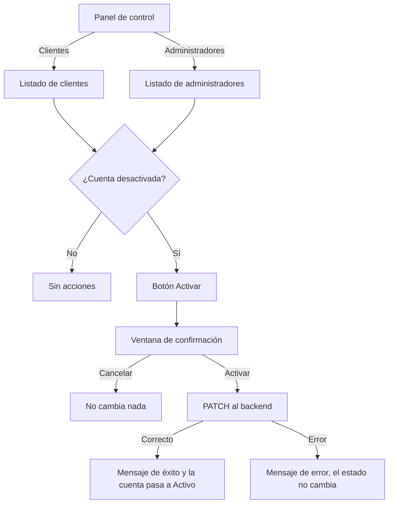

# HU24 · Activar usuario (Frontend)

Documento para entender cómo el administrador activa cuentas desactivadas, cómo se consultan los listados de clientes y administradores, qué hace cada parte del código, qué contrato espera del backend y cómo probarlo.

- **Fecha:** 8 de octubre de 2026
- **HU:** HU24 · Activar usuario
- **Tasks:** AB#35 (acción Activar y filtro por estado) y AB#36 (tests de la acción Activar)
- **Rama:** `feature/US24-T35-T36-activar-usuario`
- **Metodología:** sin TDD por decisión del equipo. Primero el código (commits `feat` con AB#35) y después los tests (commits `test` con AB#36).
- **Depende de:** `docs/hu19-listado-usuarios.md` (listado de usuarios), `docs/hu21-alta-admin-y-vendedores.md` (activar vendedores y lista de administradores), `docs/hu26-supervision-vendedores.md` (supervisión de vendedores) y `docs/mocks-msw.md` (mocks)
- **Actualizado por la HU20** (`docs/hu20-ficha-usuario.md`): los botones **Activar** y **Desactivar** están ahora en la **ficha** del usuario, que se abre con la lupa de cada fila, como en los vendedores. Las partes afectadas de este documento están actualizadas y sus tests sobre la fila se sustituyeron por los de la ficha.
- **Ampliado por la HU23** (`docs/hu23-desactivar-usuario.md`): las filas activas tienen ahora el botón **Desactivar**. `ActivateUserButton.jsx` pasó a ser `UserStatusButton.jsx` (activa y desactiva) y `activateUser` pasó a ser `updateUserStatus`. Las partes afectadas de este documento están actualizadas.

---

## 1. Resumen

El administrador activa las cuentas **desactivadas** de cualquier tipo de usuario. Antes de activar se pide confirmación.

| Usuarios | Dónde se activan | Estados posibles |
|---|---|---|
| Vendedores | **Vendedores** → lupa → diálogo → **Activar usuario** (hecho en la HU21) | Pendiente, activo y desactivado |
| Clientes | **Clientes** → lupa → ficha → **Activar** (en esta HU estaba en la fila; la HU20 lo pasó a la ficha) | Activo y desactivado |
| Administradores | **Administradores** → lupa → ficha → **Activar** (ídem) | Activo y desactivado |

> Los clientes nunca están **pendientes**: no necesitan que un administrador los acepte. Solo los vendedores pasan por ese estado.

Para esto se han conectado y completado los listados:

- **Clientes** (`/admin/clients`): nueva. La tarjeta **Clientes** del panel no llevaba a ningún sitio y ahora abre este listado, que reutiliza el de la HU19.
- **Administradores** (`/admin/admins`): ya existía (HU21) y ahora tiene los mismos filtros y el botón **Activar** (desde la HU20, en la ficha).

Los dos listados tienen:

| Control | Qué hace |
|---|---|
| Buscar por nombre | Busca en el nombre y los apellidos, no en el email |
| Estado | Todos los estados, Activo o Desactivado |
| Ordenar por | Nombre o Estado, con un botón para cambiar entre ascendente y descendente. Por defecto, nombre ascendente. Por estado, primero los activos; a igualdad, por nombre |

Cualquier cambio de búsqueda, estado u orden vuelve a la página 1. **Limpiar filtros** borra la búsqueda y el estado y mantiene la ordenación, como en el listado de vendedores.

> **Desactivar** es la HU23, que añadió después el botón **Desactivar** a las filas activas.

---

## 2. Flujo



---

## 3. Componentes y archivos

Todas las rutas son relativas a `frontend/src/`.

### Páginas y rutas

| Archivo | Qué hace |
|---|---|
| `pages/AdminClientsPage.jsx` | Listado de clientes: título, **Volver al panel** y `RoleUsersList` con el rol cliente. |
| `pages/AdminAdminsPage.jsx` | Listado de administradores: además de **Crear administrador** (HU21), usa ahora `RoleUsersList` con el rol administrador. |
| `pages/AdminPage.jsx` | La tarjeta **Clientes** lleva a `/admin/clients`. |
| `routes/paths.js` / `routes/AppRoutes.jsx` | Ruta `ADMIN_CLIENTS` (`/admin/clients`), solo para administradores. |

### Funcionalidad del administrador (`features/admin/`)

| Archivo | Qué hace |
|---|---|
| `RoleUsersList.jsx` | Listado de los usuarios de un rol, compartido por clientes y administradores: búsqueda por nombre, filtro por estado, ordenación, tabla, estado vacío y paginación. En esta HU la fila tenía el botón **Activar** y la lista mostraba los mensajes; desde la HU20 la fila tiene la lupa y ambos están en la ficha. |
| `UserStatusButton.jsx` (antes `ActivateUserButton.jsx`) | Botón **Activar** (en la fila; desde la HU20, en la ficha): abre la confirmación y llama al backend. Su nombre accesible incluye el del usuario ("Activar a Lucía Torres Vega"). Desde la HU23 también desactiva. |
| `StatusConfirmDialog.jsx` | Ventana de confirmación. Se sacó del diálogo de vendedores de la HU21 para usarla también aquí. |
| `SortControls.jsx` | "Ordenar por" y botón de sentido. Antes era `SellerSortControls.jsx` (HU26); ahora cada listado le pasa sus opciones. |
| `UsersFilters.jsx` (HU19) | El filtro de rol pasa a ser opcional, se pueden limitar los estados y cambiar el texto del buscador, y admite controles extra en la misma fila. El listado general de usuarios no cambia. |
| `UsersTable.jsx` (HU19) | Columna opcional que solo aparece si la página la pide. Se llamaba **Acciones**; desde la HU20 se llama **Información** y contiene la lupa. |
| `useUsersList.js` y `usersConfig.js` (HU19) | Pasan los parámetros nuevos (búsqueda por nombre y ordenación) y definen los estados y las opciones de orden de clientes y administradores. |
| `SellerDetailDialog.jsx` (HU26/HU21) | Usa la ventana de confirmación compartida; su comportamiento no cambia. |

### API y mocks

| Archivo | Qué hace |
|---|---|
| `api/users.js` | `listUsers` admite `searchBy`, `sort` y `order` (opcionales). Nueva `activateUser(userId)`, que la HU23 generalizó en `updateUserStatus(userId, estado)`. |
| `mocks/usersHandlers.js` | Busca solo por nombre con `searchBy=name`, ordena por nombre o estado y simula la activación. Datos: ningún cliente pendiente ni bloqueado, y un administrador desactivado (Diego Delgado Iglesias). |

---

## 4. Seguridad

- **Solo el administrador** accede a los listados (rutas protegidas) y el mock responde 401 sin sesión y 403 con otro rol. La barrera real tiene que ponerla el backend.
- **Confirmación obligatoria** antes de activar una cuenta.
- **El mock admitía solo pasar a `ACTIVO`** (400 con cualquier otro estado). Desde la HU23 admite también `DESACTIVADO`, con sus reglas.
- **Los errores del servidor se muestran con un mensaje genérico,** sin detalles internos.

---

## 5. Contrato esperado del backend

**El frontend se ha desarrollado y probado con mocks (MSW).** Las rutas y formatos de esta sección los ha definido el frontend para poder comprobar las pantallas. Si al unirlo con el backend hay diferencias, se ajustará el frontend.

### Listar usuarios (ampliación del endpoint de la HU19)

`GET /api/admin/usuarios?page=1&size=10&role=CLIENTE&status=DESACTIVADO&search=torres&searchBy=name&sort=name&order=asc`

| Parámetro nuevo | Obligatorio | Significado |
|---|---|---|
| `searchBy` | No | `name`: buscar solo en nombre y apellidos. Sin él, también en el email (HU19) |
| `sort` | No | `name` o `status`. Sin él, por fecha de alta de la más reciente a la más antigua (HU19) |
| `order` | No | `asc` o `desc` |

La ordenación debe hacerla el servidor sobre **todo** el conjunto filtrado, no sobre la página.

### Activar una cuenta

`PATCH /api/admin/usuarios/{id}/status`

```json
{ "estado": "ACTIVO" }
```

| Respuesta | Significado para el frontend |
|---|---|
| 200 + datos del usuario | Cuenta activada |
| 400 | Estado no admitido |
| 401 / 403 / 404 / 5xx | Mensaje de error; el estado no cambia |

Los vendedores se activan con su propio endpoint, `PATCH /api/admin/sellers/{id}/status` (HU21).

---

## 6. Datos de prueba y cómo verlo en el navegador

Con `npm run dev` (mocks activos): `admin@esibuy.test`, contraseña `Mock-Clave-1!`, código de correo `654321` y código de Authenticator `123456`.

| Usuarios | Datos del mock |
|---|---|
| Clientes | 15: 8 activos y 7 desactivados (dos páginas) |
| Administradores | 3: 2 activos y Diego Delgado Iglesias desactivado |

Pruebas manuales sugeridas:

1. **Panel → Clientes**, filtrar por **Desactivado**, abrir la ficha (lupa) de Lucía Torres Vega y activarla: pide confirmación, sale el mensaje y en el listado pasa a **Activo**.
2. Pulsar **Activar** y luego **Cancelar**: no cambia nada.
3. **Ordenar por: Estado** y cambiar entre ascendente y descendente.
4. Buscar `torres` (encuentra a Lucía) y `esibuy` (no encuentra a nadie, porque no busca en el email).
5. **Panel → Administradores** y activar a Diego Delgado Iglesias.

Los cambios se olvidan al recargar la página.

### Tests automáticos

```bash
npx vitest run     # 381 tests (37 nuevos de esta HU)
npm run lint
npm run build
```

| Archivo | Tests de esta HU | Qué cubre |
|---|---|---|
| `features/admin/RoleUsersList.test.jsx` | 12 | Solo el rol pedido, opciones del filtro, filtrar por estado, Activar solo en desactivados, activar con éxito y con error, ordenación por defecto, sentido y estado, búsqueda solo por nombre, estado vacío y error con reintento |
| `features/admin/UserStatusButton.test.jsx` (antes `ActivateUserButton.test.jsx`) | 5 | Botón con el nombre, confirmación, cancelar, activar y error |
| `features/admin/StatusConfirmDialog.test.jsx` | 4 | Textos, confirmar, cancelar y botones deshabilitados mientras se envía |
| `features/admin/SortControls.test.jsx` | 3 | Opciones recibidas, cambio de criterio y cambio de sentido |
| `pages/AdminClientsPage.test.jsx` | 4 | Título y clientes, volver al panel y acceso por rol |
| `features/admin/UsersFilters.test.jsx` | 3 | Sin filtro de rol, estados limitados, texto del buscador y controles extra |
| `features/admin/UsersTable.test.jsx` | 1 | Columna de acciones |
| `api/users.test.js` | 4 | Petición de activar, error, y envío o no de los parámetros nuevos |
| `pages/AdminAdminsPage.test.jsx` | 1 | Activar un administrador desactivado |

También se ajustaron un test del panel (la tarjeta **Clientes** ahora navega) y dos de la HU19 (con los datos nuevos solo hay 2 cuentas pendientes, las de los vendedores).

---

## 7. Decisiones

- **Botón Activar en la fila** para clientes y administradores. La HU20 lo pasó después a la ficha, como en los vendedores, para que todo quede igual.
- **Los clientes y los administradores solo están activos o desactivados.** "Bloqueado" se ha quitado de los datos de los clientes porque en la práctica es lo mismo que desactivado.
- **Un único componente (`RoleUsersList`) para los dos listados,** para no duplicar código, reutilizando la API, la tabla y los filtros de la HU19.
- **Los cambios en los componentes de la HU19 son opcionales,** así que la pantalla general de usuarios no cambia.
- **`SortControls` generalizado** a partir del de la HU26, en lugar de crear otro control de ordenación.
- **Las búsquedas por texto en los tests** alrededor de la confirmación, para no depender de cuándo marca Fluent la página como oculta (el problema que tienen algunos tests de la HU21).

## 8. Limitaciones y trabajo pendiente

- **Desactivar usuarios** lo hizo después la HU23 (botón, confirmación y reglas sobre administradores). De esa historia queda invalidar la sesión en el frontend; ver su documento.
- **La ficha de usuario** la hizo después la HU20, y activar está ahora en ella.
- **La pantalla general de usuarios de la HU19** (`/admin/users`) sigue sin enlace desde el panel.
- **Los tests intermitentes de la HU21** (`SellerDetailDialog.test.jsx`) pueden seguir fallando de vez en cuando con toda la suite; los de esta HU no.

---

## 9. Uso de IA generativa

Este documento y el trabajo técnico que describe se hicieron con ayuda de un asistente de IA generativa, como exige el enunciado.

- **Herramienta:** Claude (modelo de Anthropic), mediante Claude Code.
- **Qué generó la IA:** los listados, el botón Activar, la confirmación compartida, la ordenación, los cambios en los componentes y mocks de la HU19, los tests y este documento. También hizo los commits, a petición del equipo.
- **Qué hizo el equipo:**
  - decidió dónde y cómo se activa cada tipo de usuario (fila por ahora, ficha cuando exista la HU20);
  - decidió que los clientes no tengan estados pendiente ni bloqueado;
  - pidió la búsqueda solo por nombre y la ordenación por nombre o estado;
  - revisó cada paso y comprobó las pantallas en el navegador con los mocks.
- **Cómo se comprobó:** tests (381 en la suite), ESLint sin errores y build de producción correcto.
- **Qué NO se comprobó:** el flujo contra un backend real.
- **Revisión humana:** el código fue revisado, ejecutado y validado por el equipo antes de su integración. Revisado por: Alejandro.
