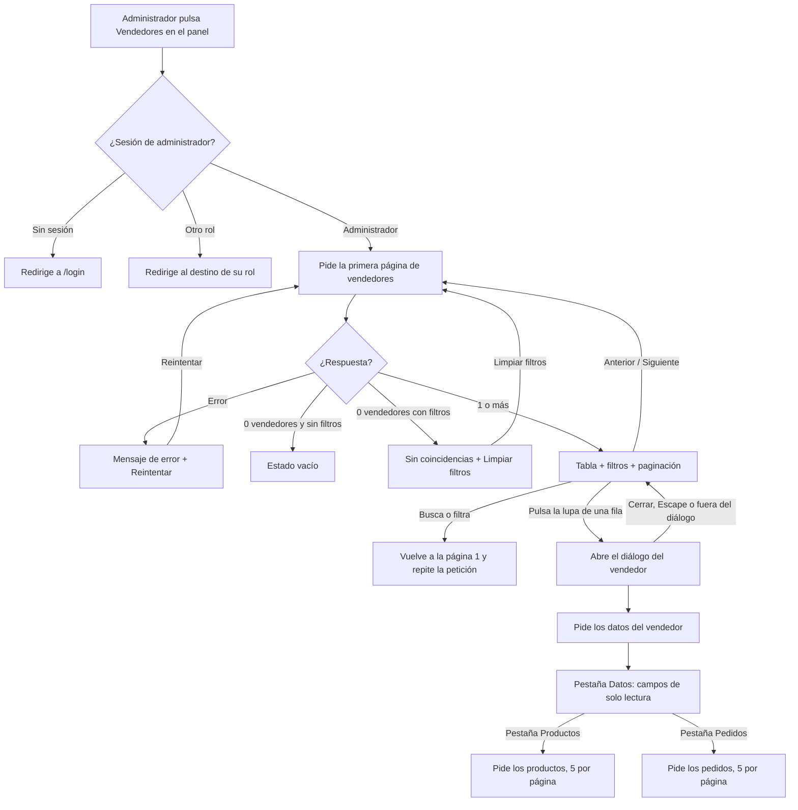
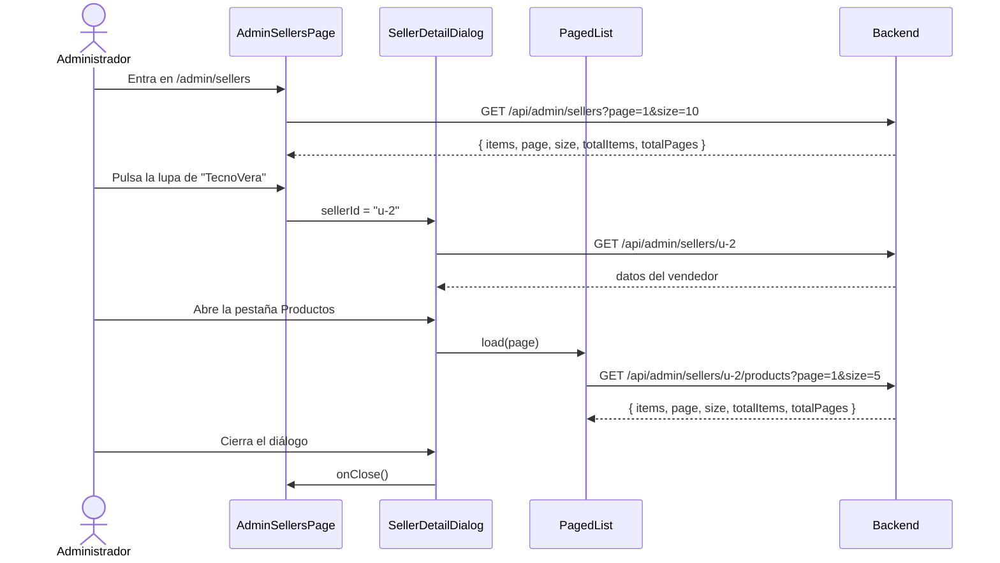

# HU26 · Supervisión de vendedores en solo lectura (Frontend)

Documento para entender cómo el administrador consulta la información de los vendedores sin poder modificarla: qué muestra, cómo fluye la información, qué hace cada componente, qué contrato espera del backend y cómo probarlo.

- **Fecha:** 8 de octubre de 2026
- **HU:** HU26 · Supervisión de vendedores (solo lectura) (3 puntos)
- **Rama:** `feature/US26-supervision-vendedores`
- **Metodología:** los tests se escribieron **antes** que la implementación (commit `test(front)` previo al `feat(front)`)
- **Depende de:** `docs/hu2-login.md` (sesión y rutas protegidas), `docs/hu18-panel-admin.md` (panel) y `docs/hu32-listado-productos.md` (tabla de productos, paginación y estados vacíos)

---

## 1. Resumen

Desde el panel de control, la tarjeta **Vendedores** lleva a `/admin/sellers`: una tabla paginada de vendedores con búsqueda y filtro por categoría. Cada fila tiene un botón con una **lupa**. Al pulsarlo se abre, **por encima del listado** (un diálogo modal, no una pestaña ni una página nueva), la información del vendedor en tres pestañas:

| Pestaña | Contenido |
|---|---|
| Datos | Nombre, apellidos, correo, nombre comercial, NIF/DNI, categoría principal, estado y fecha de alta |
| Productos | Productos del vendedor con su precio, stock y estado, paginados |
| Pedidos | Pedidos de los productos del vendedor, con fecha, artículos, total y estado, paginados |

| Criterio de aceptación | Cómo se cumple |
|---|---|
| El administrador entra en la sección de un vendedor y revisa sus productos, precios o pedidos | Lupa de cada fila, diálogo con las pestañas Datos, Productos y Pedidos. |
| Se ve toda la información pero se bloquea cualquier edición o borrado | Los campos son de solo lectura y se ven más oscuros, hay un aviso de "Modo solo lectura", los botones **Editar vendedor** y **Eliminar vendedor** están deshabilitados y las tablas no tienen ninguna acción. |

> Esto es **experiencia de usuario**. La barrera real es el backend: los endpoints de administración deben responder 401 o 403 si quien pregunta no es administrador, y no deben existir endpoints de escritura accesibles desde esta vista.

---

## 2. Flujo

### Flujo de la pantalla



### Flujo de datos



---

## 3. Componentes y archivos

Todas las rutas son relativas a `frontend/src/`.

### Páginas y rutas

| Archivo | Qué hace |
|---|---|
| `pages/AdminSellersPage.jsx` | Pantalla del listado. Orquesta filtros, tabla, paginación, estados (cargando, error, sin vendedores, sin coincidencias) y abre el diálogo del vendedor seleccionado. Incluye el enlace **Volver al panel**. |
| `pages/AdminPage.jsx` | La tarjeta **Vendedores** ahora navega a `/admin/sellers`. Las otras dos siguen sin acción (HU19 a HU24). |
| `routes/paths.js` / `routes/AppRoutes.jsx` | Nueva ruta `ADMIN_SELLERS` (`/admin/sellers`), protegida igual que el panel (solo administrador). |

### Funcionalidad del administrador (`features/admin/`)

| Archivo | Qué hace |
|---|---|
| `SellersTable.jsx` | Tabla de vendedores: nombre, nombre comercial, correo, categoría, estado y el botón de la lupa. La lupa tiene el nombre accesible "Ver información de *nombre comercial*". No tiene ninguna acción de edición o borrado. |
| `SellerDetailDialog.jsx` | Diálogo modal con el aviso de solo lectura, las pestañas y los botones **Editar vendedor** y **Eliminar vendedor**, siempre deshabilitados. Se cierra con la X, con Escape o pulsando fuera. Al abrirse pide los datos del vendedor; las pestañas Productos y Pedidos piden los suyos solo cuando se abren. |
| `SellerDataForm.jsx` | Rejilla de campos de la pestaña Datos. Son `Input` de Fluent con `readOnly` y la apariencia `filled-darker`, que los pinta con un fondo más oscuro para indicar que no se pueden modificar. Se usa `readOnly` y no `disabled` para que el texto se pueda seleccionar y copiar y lo lean los lectores de pantalla. |
| `PagedList.jsx` | Lista paginada genérica para las pestañas: pide una página, gestiona carga, error con **Reintentar**, mensaje vacío y paginación. Las pestañas solo le indican qué pedir y cómo pintar las filas. |
| `OrdersTable.jsx` | Tabla de pedidos: número, fecha, artículos, total y estado. Solo lectura. |
| `sellerStatus.js` | Traduce los estados de vendedor (activo, pendiente, desactivado) y de pedido (pendiente, enviado, entregado, cancelado) a texto y color de `Badge`. Un estado desconocido se muestra como "Desconocido". |

### Componentes y utilidades compartidas

| Archivo | Qué hace |
|---|---|
| `components/ListFilters.jsx` | Búsqueda por nombre y desplegable de categoría. Antes era `ProductFilters` (HU32); ahora recibe el texto de ayuda del buscador y lo usan los dos listados. |
| `components/tableStyles.js` | Estilos comunes de las tablas (contenedor con borde, sombra y desplazamiento, fila con resalte, atenuado al refrescar). |
| `components/pageStyles.js` | Estilos comunes de las páginas de trabajo (columna, cabecera con acción a la derecha, título y subtítulo). |
| `features/seller/ProductsTable.jsx` | Se reutiliza dentro del diálogo. Ahora admite un `label` para el nombre accesible de la tabla. |
| `hooks/useApiQuery.js` | Pide datos cuando cambia la función recibida y descarta las respuestas atrasadas. Antes estaba dentro de `useSellerProducts`. |
| `hooks/useListFilters.js` | Estado de búsqueda, categoría y página de un listado. Cualquier cambio de filtro vuelve a la página 1. |
| `hooks/useCategories.js`, `hooks/useDebouncedValue.js` | Movidos desde `features/seller/` para compartirlos. |
| `utils/format.js` | `formatPrice` (euros) y `formatDate` (DD/MM/AAAA, sin desfase por zona horaria). |

### API y mocks

| Archivo | Qué hace |
|---|---|
| `api/adminSellers.js` | `getAdminSellers`, `getAdminSeller`, `getAdminSellerProducts` y `getAdminSellerOrders`. |
| `api/query.js` | Construye la cadena de consulta omitiendo los valores vacíos. |
| `mocks/adminSellersHandlers.js` | Simula los cuatro endpoints. Solo responden al administrador (401 sin sesión, 403 con otro rol, 404 si el vendedor no existe). |
| `mocks/paginar.js` | Paginación y normalización de texto compartidas por los mocks. |
| `mocks/productsHandlers.js` | Exporta sus datos para que los reutilice el mock de administración. |

---

## 4. Contrato esperado del backend

Las rutas y los formatos los ha definido el frontend; **hay que acordarlos con quien desarrolle el backend**. Todos son de solo lectura (`GET`) y exigen sesión de administrador.

| Endpoint | Parámetros | Respuesta 200 |
|---|---|---|
| `GET /api/admin/sellers` | `page`, `size`, `search` (opcional), `category` (opcional, id) | Página de vendedores |
| `GET /api/admin/sellers/{id}` | | Datos del vendedor |
| `GET /api/admin/sellers/{id}/products` | `page`, `size` | Página de productos (mismo formato que `GET /api/seller/products`) |
| `GET /api/admin/sellers/{id}/orders` | `page`, `size` | Página de pedidos |

Las páginas tienen el formato `{ items, page, size, totalItems, totalPages }`.

Vendedor en el listado:

```json
{ "id": "u-2", "nombre": "Vera", "apellidos": "Vendedora", "nombreComercial": "TecnoVera",
  "email": "vendedor@esibuy.test", "categoriaPrincipal": "Tecnología", "estado": "ACTIVO" }
```

Datos del vendedor: lo anterior más `"nif": "B12345601"` y `"fechaAlta": "2026-09-14"`.

Pedido: `{ "id": "PED-1012", "fecha": "2026-10-06", "articulos": 2, "total": 94.4, "estado": "PENDIENTE" }`.

| Valor | Posibles |
|---|---|
| `estado` del vendedor | `ACTIVO`, `PENDIENTE`, `DESACTIVADO` |
| `estado` del pedido | `PENDIENTE`, `ENVIADO`, `ENTREGADO`, `CANCELADO` |

| Estado HTTP | Significado para el frontend |
|---|---|
| 401, 403, 404, 5xx | Mensaje de error con **Reintentar** (nunca se muestra el texto del servidor) |

Notas:

- La búsqueda debe cubrir nombre, apellidos, nombre comercial y correo, sin distinguir mayúsculas ni acentos.
- `category` filtra por la **categoría principal** del vendedor (la que elige en el registro).
- Hay que acordar si el estado `BLOQUEADO` (mencionado en el documento de contexto) existe también para vendedores; hoy el frontend lo mostraría como "Desconocido".
- Un pedido muestra solo datos agregados. No incluye datos personales del cliente.

---

## 5. Datos de prueba y cómo verlo en el navegador

Con `npm run dev` (mocks activos): `admin@esibuy.test`, contraseña `Mock-Clave-1!`, código de correo `654321` y código de Authenticator `123456`. Después, **Panel de control → Vendedores**.

| Vendedor del mock | Qué sirve para probar |
|---|---|
| `TecnoVera` (`vendedor@esibuy.test`) | 23 productos y 12 pedidos: paginación de las pestañas |
| `Casa Vicente` (`vendedor-vacio@esibuy.test`) | Sin productos ni pedidos: mensajes vacíos |
| `Otero Hogar y Tecnología` | 3 productos y 2 pedidos |
| `Hogar Hugo`, `Molina Informática` | Estado Pendiente |
| `Cocina Pablo`, `Bravo Audio` | Estado Desactivado |

Hay 14 vendedores: dos páginas en el listado (10 y 4); 7 son de Tecnología y 7 de Hogar.

Pruebas manuales sugeridas:

1. Recorrer las dos páginas del listado.
2. Buscar `lucia` (sin acento) y `hugo@esibuy` (por correo).
3. Filtrar por **Hogar** y comprobar que todas las filas son de esa categoría.
4. Buscar `zzzz`: "sin coincidencias" y **Limpiar filtros**.
5. Pulsar la lupa de `TecnoVera`: se abre el diálogo y el listado sigue detrás, con la misma dirección en la barra.
6. Intentar escribir en los campos de la pestaña Datos: no cambian. Comprobar que el fondo es más oscuro que el del resto del diálogo.
7. Comprobar que **Editar vendedor** y **Eliminar vendedor** están deshabilitados.
8. En Productos y Pedidos, pasar de página con **Siguiente**.
9. Cerrar con la X, con Escape y pulsando fuera del diálogo.
10. Con `vendedor@esibuy.test`, abrir `/admin/sellers` a mano: debe redirigir a `/seller/products`.

### Tests automáticos

```bash
npx vitest run     # 123 tests (41 son de esta HU)
npm run lint
npm run build
```

| Archivo | Qué cubre |
|---|---|
| `pages/AdminSellersPage.test.jsx` | 24 tests: acceso y roles, listado, estados, filtros, paginación, apertura y cierre del diálogo y rechazo del servidor a quien no es administrador. |
| `features/admin/SellerDetailDialog.test.jsx` | 17 tests: datos de solo lectura, aviso, botones deshabilitados, cierre, errores, y las pestañas Productos y Pedidos (datos, paginación, vacío, sin acciones de edición). |
| `pages/AdminPage.test.jsx` | Un test ajustado: ahora comprueba que **Clientes** (aún sin acción) no navega, y el nuevo test de **Vendedores** está en `AdminSellersPage.test.jsx`. |

Los 82 tests anteriores siguen pasando, lo que valida la reorganización de componentes compartidos (sección 6).

---

## 6. Decisiones y librerías

- **No se ha añadido ninguna librería nueva.** Se usan componentes de Fluent UI que ya estaban disponibles (`Dialog`, `TabList`/`Tab`, `Input`, `Field`, `Table`, `Badge`, `MessageBar`) y los iconos de `@fluentui/react-icons`.
- **Diálogo modal y no página:** el administrador no pierde el listado, la búsqueda ni la página en la que estaba al cerrar. El diálogo no cambia la dirección del navegador, así que no se puede enlazar ni recuperar al recargar. Si hiciera falta, habría que pasar el vendedor seleccionado a la URL.
- **Solo lectura con `readOnly` y no `disabled`:** un campo deshabilitado no se puede seleccionar ni leer bien con teclado. La apariencia `filled-darker` de Fluent da el fondo más oscuro pedido sin crear colores nuevos.
- **Botones de editar y eliminar deshabilitados, visibles:** así el criterio "bloquea cualquier opción de edición o borrado" se ve en pantalla. No hay acciones de ningún tipo en las filas de las tablas.
- **Pestañas con carga bajo demanda:** Productos y Pedidos solo piden datos al abrirse, para no cargar el diálogo con tres peticiones.
- **Reutilización:** se extrajeron `useApiQuery`, `useListFilters`, `ListFilters`, `tableStyles`, `pageStyles` y `format` para no duplicar el código del listado de productos (HU32), que se reescribió sobre ellos. Esto se hizo para cumplir el límite de duplicación de SonarQube.

## 7. Limitaciones y trabajo pendiente

- Las tarjetas **Clientes** y **Administradores** del panel siguen sin acción (HU19 a HU24).
- No se puede ordenar por columnas ni exportar.
- El modelo de pedido es mínimo: no hay detalle de líneas ni datos del cliente, porque no hay una historia de pedidos definida todavía.
- La pestaña de pedidos y los estados son una propuesta del frontend; hay que validarlos con el backend y con la historia de pedidos.
- Aspecto visual sin revisar en un navegador real (ver sección 8).

---

## 8. Uso de IA generativa

Este documento y el trabajo técnico que describe se hicieron con ayuda de un asistente de IA generativa, como exige el enunciado.

- **Herramienta:** Claude (modelo de Anthropic), mediante Claude Code.
- **Qué generó la IA:** el listado de vendedores, el diálogo de información, sus pestañas, los hooks y componentes compartidos, los mocks, los tests y este documento. Las decisiones de producto las tomó el equipo: la tabla paginada con búsqueda y filtro por categoría, la lupa en cada fila, que la información se abra por encima del listado y no en una pestaña, y los campos más oscuros por ser de solo lectura.
- **Cómo se comprobó:** se ejecutaron los **123 tests (todos en verde)**, ESLint sin errores y un build de producción correcto. Los tests se escribieron antes que la implementación.
- **Qué NO se comprobó:** la pantalla en un navegador real ni su aspecto visual (por ejemplo, el contraste de los campos de solo lectura), ni el flujo contra un backend real. El contrato de la sección 4 debe acordarse con el backend.
- **Cómo guió el proceso:** el asistente siguió el flujo de ramas y commits del proyecto (reorganización, mocks, tests, implementación y documentación en commits separados) y el sistema de diseño de `DESIGN.md`.
- **Revisión humana:** el código fue revisado, ejecutado y validado por el equipo antes de su integración. Revisado por: Ricardo.
