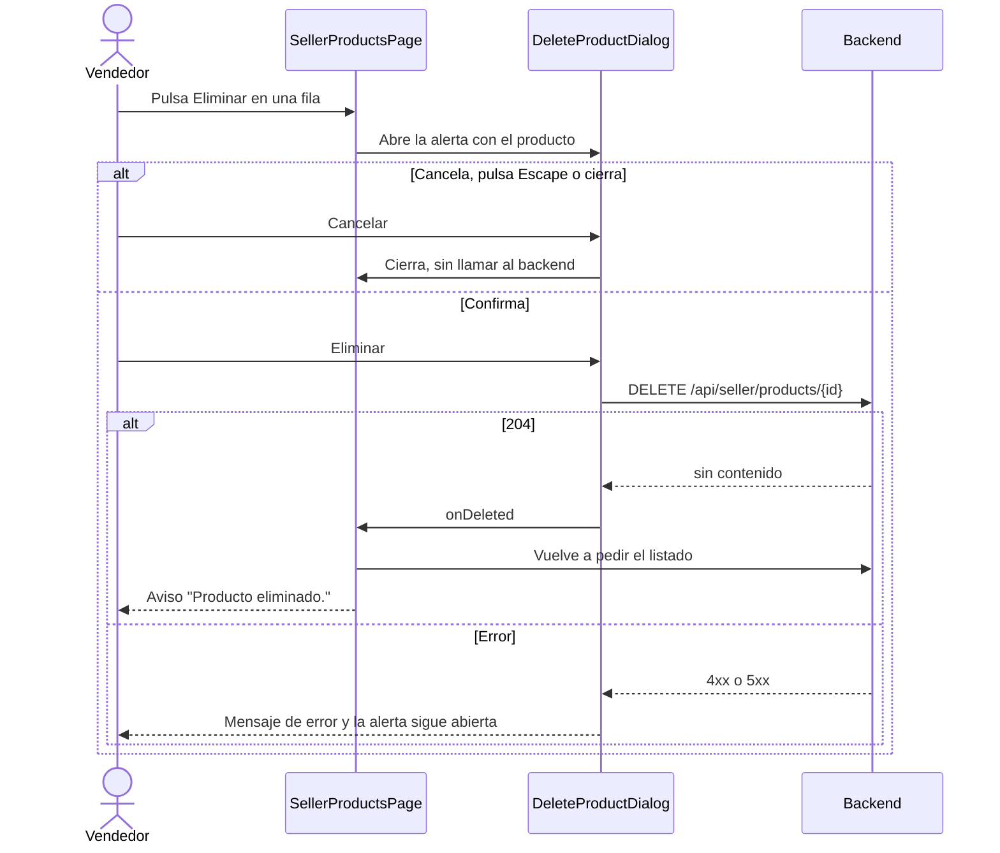

# HU31 · Dar de alta un producto (Frontend)

Documento para entender el formulario de producto del vendedor, que sirve para añadir y para editar, y las acciones de editar y eliminar del listado: qué hace cada pieza, cómo se valida, qué contrato espera del backend y cómo probarlo.

- **Fecha:** 8 de octubre de 2026
- **HU:** HU31 · Dar de alta un producto (3 puntos). Incluye, por petición del equipo, editar y eliminar desde el listado de la HU32
- **Rama:** `feature/US31-formulario-producto`
- **Metodología:** los tests se escribieron **antes** que la implementación (commit `test(front)` previo al `feat(front)`)
- **Depende de:** `docs/hu32-listado-productos.md` (listado, paginación y estados), `docs/hu2-login.md` (sesión y rutas protegidas) y `docs/mocks-msw.md` (mocks)

---

## 1. Resumen

| Dónde | Qué ocurre |
|---|---|
| Listado `/seller/products` | Cada fila tiene un botón **Editar** (lápiz) y un botón **Eliminar** (papelera). |
| `/seller/products/new` | Pulsar **Añadir producto** abre el formulario vacío con todos los campos del producto y un botón **Guardar**. |
| `/seller/products/:id/edit` | **Editar** abre **el mismo formulario** con los datos del producto cargados. |
| Eliminar | Abre una alerta de confirmación ("Esta acción no se puede deshacer"). Solo al confirmar se pide el borrado. |

**A efectos prácticos del frontend, ni se añaden ni se eliminan productos:** con los mocks, guardar y eliminar responden como el backend real (validan y devuelven éxito o error) pero **no modifican** los datos de ejemplo. El listado, por tanto, sigue mostrando los mismos productos. El contrato real está en la sección 5.

| Criterio de aceptación | Cómo se cumple |
|---|---|
| Vista dedicada con los campos del producto | Página propia, no un diálogo: `SellerProductFormPage`. |
| Se validan obligatorios, precio > 0 y stock ≥ 0 | `validateProduct` (sección 4). Se muestran **todos los errores a la vez** y no se llama al servidor si hay alguno. |
| El producto queda asociado al vendedor autenticado | El frontend **no envía ningún identificador de vendedor**: el backend lo deduce de la sesión. Hay un test que lo comprueba. |
| Tras guardarlo, aparece en el catálogo visible para los clientes | Depende del backend (el producto se guarda con `disponible: true` por defecto). El catálogo de clientes (`/products`) es todavía una página vacía; esta condición no es comprobable en el frontend hasta que exista. |

> Ocultar o mostrar pantallas es **experiencia de usuario**. El backend debe validar de nuevo todo lo que se valida aquí, responder 401 o 403 si quien llama no es vendedor, y no dejar que un vendedor lea, modifique o borre productos de otro.

---

## 2. Flujo

### Alta y edición

```mermaid
flowchart TD
    A[Listado de productos] -- Añadir producto --> B[/seller/products/new]
    A -- Editar en una fila --> C[/seller/products/id/edit]
    C --> D{¿Carga el producto?}
    D -- 404 --> E[Mensaje: no se ha encontrado el producto]
    D -- Error --> F[Mensaje + Reintentar]
    F -- Reintentar --> C
    D -- OK --> G[Formulario con los datos]
    B --> G2[Formulario vacío]
    G --> H[Guardar]
    G2 --> H
    H --> I{¿Datos válidos?}
    I -- No --> J[Todos los errores a la vez, sin llamar al servidor]
    J -- Corrige un campo --> K[Se revalida en vivo]
    K --> H
    I -- Sí --> L[POST o PUT al backend]
    L -- Error --> M[Mensaje genérico, el formulario conserva los datos]
    M --> H
    L -- OK --> N[Vuelve al listado con el aviso de guardado]
```

### Eliminar



---

## 3. Componentes y archivos

Todas las rutas son relativas a `frontend/src/`.

### Página y rutas

| Archivo | Qué hace |
|---|---|
| `pages/SellerProductFormPage.jsx` | Una sola pantalla para alta (ruta sin `:id`) y edición (ruta con `:id`), en una columna centrada de 720 px. Carga las categorías y, si edita, el producto; gestiona los estados (cargando, categorías que fallan, producto no encontrado, error con **Reintentar**), envía los datos y, si todo va bien, vuelve al listado con un aviso. Sustituye a la antigua página vacía `SellerProductNewPage`. |
| `routes/paths.js` / `routes/AppRoutes.jsx` | Nueva ruta `SELLER_PRODUCT_EDIT` (`/seller/products/:id/edit`) y la función `getSellerProductEditPath(id)`. Ambas rutas están protegidas igual que el listado (solo vendedor). |

### Formulario (`features/seller/`)

| Archivo | Qué hace |
|---|---|
| `ProductForm.jsx` | Los campos del producto (precio y stock en la misma fila, alineados aunque el stock lleve un texto de ayuda) y los botones **Guardar** y **Cancelar**. Hasta el primer intento de guardar no muestra errores; después valida en vivo. Mientras guarda deshabilita **Guardar** (evita el doble envío). Si el envío falla, conserva lo escrito y muestra un mensaje genérico. |
| `DiscountField.jsx` | Interruptor de un descuento y, solo si está activo, el campo de su porcentaje. Se usa dos veces: descuento y descuento premium. |
| `productValues.js` | Lógica del formulario sin interfaz: `emptyProductValues`, `valuesFromProduct` (producto del backend a valores del formulario), `validateProduct` (todas las reglas) y `toProductPayload` (valores del formulario al cuerpo de la petición). |
| `ProductRowActions.jsx` | Botones de editar (lápiz, enlace al formulario) y eliminar (papelera) de cada fila del listado. |
| `DeleteProductDialog.jsx` | Alerta de confirmación de borrado (`role="alertdialog"`). Cancelar, Escape y el botón de cierre salen sin borrar. Mientras borra, bloquea los botones. Si falla, el mensaje se muestra dentro de la alerta y esta sigue abierta. |
| `ProductsTable.jsx` | Admite una propiedad opcional `renderActions` que añade la columna **Acciones**. El listado del vendedor la usa; la tabla del administrador (HU26) no, por lo que sigue siendo de solo lectura. |

### Campos del formulario

| Campo | Obligatorio | Regla |
|---|---|---|
| Nombre | Sí | No vacío; hasta 100 caracteres |
| Categorías | Sí | Al menos una, de las que devuelve `GET /api/categorias` |
| Precio (€) | Sí | Número **mayor que 0** |
| Stock | No | Entero **mayor o igual que 0**; si se deja vacío se envía 0 |
| Descripción | No | Hasta 1000 caracteres |
| URL de la imagen | No | Si se rellena, una dirección `http` o `https` |
| Activar descuento / Descuento (%) | No | Si está activo, porcentaje mayor que 0 y hasta 100 |
| Activar descuento premium / Descuento premium (%) | No | Igual que el anterior |
| Disponible para la venta | No | Activado por defecto |

El descuento se aplica a todos los clientes y el premium solo a los premium. **Los descuentos se acumulan**: un cliente premium recibe ambos. El formulario lo recuerda con un texto. Cómo se combinan los porcentajes al calcular el precio final (sumarlos o aplicarlos uno tras otro) lo decide el backend.

### Páginas, hooks y mocks que cambian

| Archivo | Qué cambia |
|---|---|
| `pages/SellerProductsPage.jsx` | Añade las acciones de cada fila, la alerta de borrado y un aviso (llega por el estado de la navegación tras guardar, o se genera al eliminar) que se puede cerrar. Tras eliminar vuelve a pedir el listado. |
| `hooks/useApiQuery.js` | Ahora también devuelve el `error`, para poder distinguir "no encontrado" (404) de otros fallos. |
| `hooks/useCategories.js` | Ahora devuelve `{ categories, loaded, failed, retry }` y se apoya en `useApiQuery`. Los filtros siguen funcionando sin categorías; el formulario sí avisa si no cargan. |
| `api/products.js` | `getSellerProduct`, `createSellerProduct`, `updateSellerProduct` y `deleteSellerProduct`. |
| `mocks/productsHandlers.js` | Simula los cuatro endpoints nuevos. Valida igual que el backend real, solo deja ver y tocar al dueño del producto (404 para el resto) y **no modifica los datos**. Añade descripción, imagen y descuentos a los productos de ejemplo. |

---

## 4. Validación

- **Todos los errores a la vez.** Al pulsar **Guardar** se evalúan todos los campos y se muestran todos los fallos juntos. No se llama al servidor.
- **En vivo después del primer intento.** Una vez intentado guardar, cada cambio revalida y el error desaparece en cuanto el campo es correcto.
- **Cada mensaje explica el motivo**, p. ej. "El precio debe ser mayor que 0.".
- **El servidor también valida** (el mock lo hace como el backend real). Si rechaza los datos, el formulario muestra el mensaje genérico "No se ha podido guardar el producto", nunca el texto del error.

---

## 5. Contrato esperado del backend

Las rutas y los formatos los ha definido el frontend; **hay que acordarlos con quien desarrolle el backend**. Todos exigen sesión de vendedor.

| Endpoint | Cuerpo | Respuesta correcta |
|---|---|---|
| `POST /api/seller/products` | Producto (abajo) | 201 con el producto creado |
| `GET /api/seller/products/{id}` | | 200 con el producto |
| `PUT /api/seller/products/{id}` | Producto (abajo) | 200 con el producto actualizado |
| `DELETE /api/seller/products/{id}` | | 204 |

Cuerpo de `POST` y `PUT` (y respuesta de `GET`, que además incluye `id`):

```json
{
  "nombre": "Lámpara de pie",
  "descripcion": "",
  "precio": 45.5,
  "stock": 7,
  "categoriaIds": ["cat-2"],
  "imagen": "",
  "disponible": true,
  "descuento": { "activo": true, "porcentaje": 10 },
  "descuentoPremium": { "activo": false, "porcentaje": null }
}
```

| Estado | Significado para el frontend |
|---|---|
| 400 (con `{ "code": "VALIDATION_ERROR" }`), 401, 403, 5xx | Mensaje genérico de error |
| 404 en `GET` | "No se ha encontrado el producto" |

Reglas que el backend debe imponer (las mismas del formulario): nombre no vacío, al menos una categoría existente, `precio > 0`, `stock` entero ≥ 0, y porcentajes entre 0 (excluido) y 100 cuando el descuento está activo.

Notas:

- **El vendedor no viaja en el cuerpo.** El backend lo toma de la sesión y asocia el producto automáticamente. En `GET`, `PUT` y `DELETE` solo debe poder actuar sobre productos propios (404 para los ajenos, para no revelar su existencia).
- En el listado (`GET /api/seller/products`) las categorías llegan como **nombres**, y en el detalle como **identificadores** (`categoriaIds`), que son los que usa el formulario. Hay que mantener esa diferencia o unificarla.
- La imagen es, por ahora, una **URL**. Si se decide subir archivos, habrá que cambiar el contrato (envío multipart) y el cliente HTTP.
- Tras crear o editar un producto con `disponible: true`, debe aparecer en el catálogo de clientes.

---

## 6. Datos de prueba y cómo verlo en el navegador

Con `npm run dev` (mocks activos), entra como `vendedor@esibuy.test` (contraseña `Mock-Clave-1!`, código de correo `654321`, código de Authenticator `123456`).

Pruebas manuales sugeridas:

1. En **Mis productos**, pulsar **Añadir producto**: aparece el formulario vacío.
2. Pulsar **Guardar** sin rellenar nada: salen a la vez el nombre, las categorías y el precio. Corregir uno y ver que su error desaparece.
3. Probar precio `0`, stock `-1`, stock `1.5` y una imagen que no sea una dirección web.
4. Activar **Activar descuento**: aparece el porcentaje. Dejarlo vacío y guardar.
5. Rellenar un producto válido y guardar: se vuelve al listado con "Producto guardado correctamente." (el producto no se añade a la lista, ver la sección 1).
6. Pulsar el lápiz de una fila: el formulario se abre con los datos. Los dos primeros productos de ejemplo tienen descuentos activos.
7. Abrir `/seller/products/p-24/edit` (producto de otro vendedor del mock) y `/seller/products/no-existe/edit`: "No se ha encontrado el producto".
8. Pulsar la papelera: aparece la alerta. **Cancelar** y **Escape** salen sin borrar; **Eliminar** cierra, muestra "Producto eliminado." y recarga el listado (el producto sigue, ver la sección 1).
9. Entrar como administrador, abrir **Vendedores**, la lupa de un vendedor y su pestaña **Productos**: no hay botones de editar ni eliminar.

### Tests automáticos

```bash
npx vitest run     # 264 tests (78 son de esta HU)
npm run lint
npm run build
```

| Archivo | Qué cubre |
|---|---|
| `features/seller/productValues.test.js` | 39 tests: cada regla de validación (valores límite incluidos), conversión a la petición y vuelta atrás. |
| `pages/SellerProductFormPage.test.jsx` | 29 tests: campos, texto de acumulación de descuentos, alta, validación, guardado (datos enviados, sin vendedor, errores del servidor, doble clic), edición, producto ajeno o inexistente y acceso por rol. |
| `pages/SellerProductsPage.test.jsx` | 10 tests nuevos: botones por fila, apertura del formulario de edición, alerta de borrado (cancelar, confirmar, error, Escape), recarga del listado y que la tabla del administrador no tiene esos botones. |

Los 186 tests anteriores siguen pasando.

La centrada del formulario y la alineación de precio y stock se comprobaron midiendo los elementos en el navegador (mismo borde superior y márgenes laterales equivalentes), no con tests automáticos.

---

## 7. Decisiones y librerías

- **No se ha añadido ninguna librería nueva.** Todo sale de Fluent UI (`Field`, `Input`, `Textarea`, `Checkbox`, `Switch`, `Dialog`) y de los iconos que ya usa el proyecto.
- **Una pantalla para alta y edición:** evita duplicar el formulario y garantiza que ambas acciones validan igual.
- **Categorías con casillas y no con desplegable múltiple:** es el mismo patrón del registro de vendedor y es más fácil de usar y de probar con teclado.
- **Imagen como URL:** subir archivos exigiría un envío distinto (multipart) que el cliente HTTP no tiene. Se deja como decisión pendiente con backend.
- **Aviso al volver al listado:** como los mocks no añaden el producto, el aviso es la única confirmación visible. Viaja en el estado de la navegación, así que reaparece si se recarga la página; no se guarda en el navegador.
- **Nombre del archivo `productValues.js`:** un archivo `productForm.js` convivía mal con `ProductForm.jsx` en sistemas de ficheros que no distinguen mayúsculas (Windows), y un `import` acababa cogiendo el archivo equivocado.

## 8. Limitaciones y trabajo pendiente

- Con los mocks no se añade ni se elimina ningún producto (ver la sección 1).
- El catálogo de clientes sigue vacío, así que "aparece en el catálogo" no es comprobable todavía.
- No hay vista previa de la imagen ni se ofrecen imágenes predefinidas.
- No hay aviso de cambios sin guardar al salir del formulario.
- La edición no avisa si el producto cambió en el servidor mientras se editaba.
- Está pendiente decidir si el descuento premium debe ser mayor o igual que el normal, y cómo se combinan los porcentajes (ver la sección 3).

---

## 9. Uso de IA generativa

Este documento y el trabajo técnico que describe se hicieron con ayuda de un asistente de IA generativa, como exige el enunciado.

- **Herramienta:** Claude (modelo de Anthropic), mediante Claude Code.
- **Qué generó la IA:** el formulario, su validación, las acciones de editar y eliminar, los mocks, los tests y este documento. Las decisiones de producto las tomó el equipo: los criterios de la HU31, que el formulario sirva también para editar, la alerta de confirmación al eliminar, y que en el frontend no se añadan ni eliminen productos de verdad.
- **Cómo se comprobó:** se ejecutaron los **264 tests (todos en verde)**, ESLint sin errores y un build de producción correcto. Los tests se escribieron antes que la implementación.
- **Qué NO se comprobó:** el aspecto visual completo (solo se midió la alineación de precio y stock y la centrada del formulario), ni el flujo contra un backend real. El contrato de la sección 5 debe acordarse con el backend.
- **Cómo guió el proceso:** el asistente siguió el flujo de ramas y commits del proyecto (mocks, tests, implementación y documentación en commits separados) y el sistema de diseño de `DESIGN.md`.
- **Revisión humana:** el código fue revisado, ejecutado y validado por el equipo antes de su integración. Revisado por: Ricardo.
