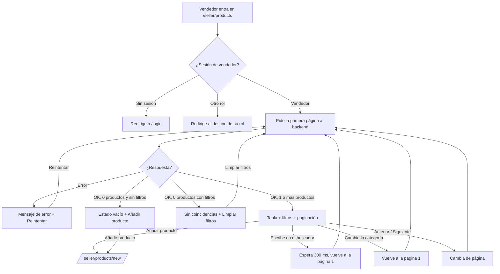
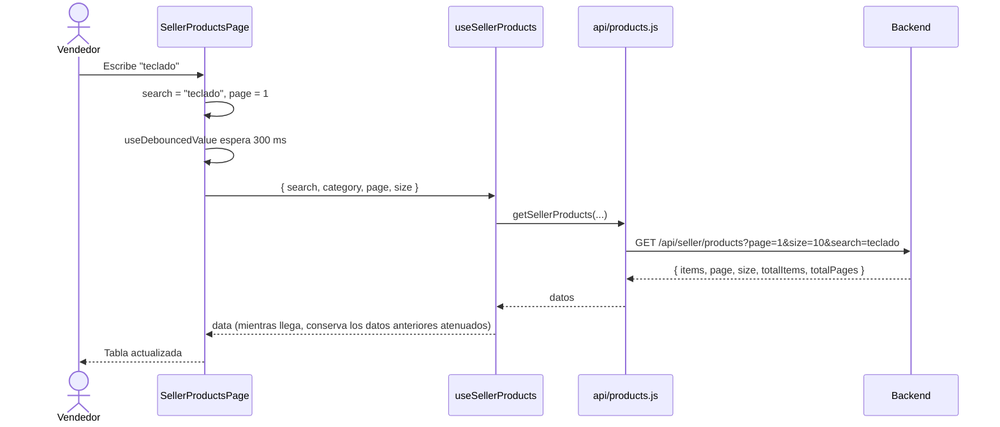

# HU32 · Listar mis productos (Frontend)

Documento para entender el listado de productos del vendedor: qué muestra, cómo fluye la información, qué hace cada componente, qué contrato espera del backend y cómo probarlo.

- **Fecha:** 7 de octubre de 2026
- **HU:** HU32 · Listar mis productos (2 puntos)
- **Rama:** `feature/US32-listado-productos-vendedor`
- **Metodología:** los tests se escribieron **antes** que la implementación (commit `test(front)` previo al `feat(front)`)
- **Depende de:** `docs/hu2-login.md` (sesión y rutas protegidas) y `docs/mocks-msw.md` (mocks)

---

## 1. Resumen

El vendedor autenticado ve en `/seller/products` una tabla con **sus** productos, paginada de 10 en 10, con búsqueda por nombre y filtro por categoría. El botón **Añadir producto** está siempre en la cabecera de la página, tenga o no productos. Es un enlace a `/seller/products/new` y **no** forma parte de `AppHeader`.

| Criterio de aceptación | Cómo se cumple |
|---|---|
| Solo los productos del vendedor autenticado | El frontend **no envía ningún identificador de vendedor**: el backend lo deduce de la sesión (cookie). El mock lo reproduce y hay un test que lo comprueba. |
| Buscar por nombre y filtrar por categoría | `ListFilters`: búsqueda con retardo de 300 ms (sin botón) y desplegable de categorías. Se pueden combinar. |
| Listado paginado | `Pagination` + parámetros `page` y `size` en la petición. La paginación y el filtrado los hace el **servidor**. |
| Estado vacío con acceso a "Añadir producto" | `EmptyState` con el enlace, solo cuando el vendedor no tiene ningún producto (sin filtros activos). |

> Ocultar o mostrar pantallas es **experiencia de usuario**. El backend debe responder 401 o 403 si quien consulta no es un vendedor, y devolver únicamente sus productos.

---

## 2. Flujo

### Flujo de la pantalla



### Flujo de datos



---

## 3. Componentes y archivos

Todas las rutas son relativas a `frontend/src/`.

### Página y ruta

| Archivo | Qué hace |
|---|---|
| `pages/SellerProductsPage.jsx` | Orquesta la pantalla. Guarda el estado de los filtros (`search`, `category`, `page`), decide cuál de los cinco estados mostrar (cargando, error, vacío, sin coincidencias, tabla) y coloca el botón **Añadir producto**. Cada cambio de filtro vuelve a la página 1. |
| `pages/SellerProductFormPage.jsx` | Destino de **Añadir producto**: el formulario de alta y edición de la HU31 (ver `docs/hu31-formulario-producto.md`). |
| `routes/paths.js` / `routes/AppRoutes.jsx` | Nueva ruta `SELLER_PRODUCT_NEW` (`/seller/products/new`), protegida igual que el listado (solo vendedor). |

### Funcionalidad del vendedor (`features/seller/`)

| Archivo | Qué hace |
|---|---|
| `ProductsTable.jsx` | Tabla con producto, categorías (etiquetas), precio en euros, stock y estado. El stock 0 se resalta en rojo. Mientras se carga otra página los datos anteriores se atenúan (`aria-busy`) en lugar de desaparecer. |
| `useSellerProducts.js` | Pide el listado cuando cambian los filtros. Es un envoltorio de `hooks/useApiQuery.js`. |

### Componentes reutilizables (`components/`)

| Archivo | Qué hace |
|---|---|
| `Pagination.jsx` | Botones **Anterior** y **Siguiente**, "Página X de Y" y "Mostrando A–B de N". No se muestra si solo hay una página. No sabe nada de productos (el texto "productos" llega por la propiedad `itemLabel`), así que sirve para el resto de listados (HU19, HU26). |
| `ListFilters.jsx` | Campo de búsqueda por nombre (`SearchBox`) y desplegable de categoría (`Select`), con sus etiquetas. No guarda estado: lo recibe de la página. |
| `EmptyState.jsx` | Tarjeta con icono, título, descripción y un hueco para la acción. Se usa para "sin productos" y "sin coincidencias". |

### Hooks (`hooks/`)

| Archivo | Qué hace |
|---|---|
| `useApiQuery.js` | Ejecuta una petición cuando cambia la función recibida. Descarta las respuestas atrasadas (si el usuario escribe rápido, solo cuenta la última). Expone `data`, `error`, `failed`, `refreshing` y `retry`. |
| `useCategories.js` | Carga las categorías del desplegable y devuelve `{ categories, loaded, failed, retry }`. Si falla, el filtro queda solo con "Todas las categorías" y el listado sigue funcionando. |
| `useDebouncedValue.js` | Retrasa un valor 300 ms para no pedir al servidor una vez por cada tecla. |

### API y mocks

| Archivo | Qué hace |
|---|---|
| `api/products.js` | `getSellerProducts({ search, category, page, size })` y `getCategories()`. Construye la consulta con `URLSearchParams` y omite los filtros vacíos. |
| `mocks/productsHandlers.js` | Simula `GET /api/seller/products`: filtra por vendedor en sesión, nombre (sin distinguir mayúsculas ni acentos) y categoría, y pagina. |
| `mocks/authHandlers.js` | Añade `getUsuarioEnSesion()` (lo usa el mock de productos para saber quién pregunta) y el usuario `vendedor-vacio@esibuy.test`. |
| `mocks/handlers.js` | Registra los nuevos handlers. |

---

## 4. Estados de la pantalla

| Estado | Cuándo | Qué se ve |
|---|---|---|
| Cargando | Primera carga | Indicador "Cargando tus productos…". Aún no hay filtros. |
| Error | La petición falla | Mensaje fijo y botón **Reintentar**. Nunca se muestra el texto del error del servidor. |
| Sin productos | 0 productos **y** sin filtros activos | Tarjeta "Todavía no tienes productos" con **Añadir producto**. No hay filtros ni paginación. |
| Sin coincidencias | 0 resultados con algún filtro activo | "No hay productos que coincidan" con **Limpiar filtros**. Los filtros siguen visibles. |
| Con productos | 1 o más | Filtros, tabla y paginación (si hay más de una página). |

Dinamismo: la búsqueda filtra mientras se escribe, el cambio de página o de filtro atenúa la tabla en vez de vaciarla, las filas resaltan al pasar el ratón y las transiciones se desactivan si el sistema tiene activado "reducir movimiento".

---

## 5. Contrato esperado del backend

La ruta y el formato de respuesta los ha definido el frontend; **hay que acordarlos con quien desarrolle el backend**.

`GET /api/seller/products?page=1&size=10&search=teclado&category=cat-2`

| Parámetro | Obligatorio | Significado |
|---|---|---|
| `page` | Sí | Página, empezando en 1 |
| `size` | Sí | Elementos por página (el frontend envía 10) |
| `search` | No | Texto contenido en el nombre, sin distinguir mayúsculas ni acentos |
| `category` | No | Identificador de la categoría |

Respuesta 200:

```json
{
  "items": [
    { "id": "p-1", "nombre": "Teclado mecánico", "precio": 89.5, "stock": 12, "disponible": true, "categorias": ["Tecnología"] }
  ],
  "page": 1,
  "size": 10,
  "totalItems": 23,
  "totalPages": 3
}
```

| Estado | Significado para el frontend |
|---|---|
| 401 / 403 / 5xx | Mensaje de error con **Reintentar** |

- Las categorías de cada producto llegan como **nombres**; el filtro envía el **identificador** (el que devuelve `GET /api/categorias`).
- El backend debe obtener al vendedor de la **sesión**, nunca de un parámetro.
- `totalPages` es 0 cuando no hay resultados.

---

## 6. Datos de prueba y cómo verlo en el navegador

Con `npm run dev` (mocks activos), contraseña `Mock-Clave-1!`, código de correo `654321` y código de Authenticator `123456`:

| Usuario | Qué muestra |
|---|---|
| `vendedor@esibuy.test` | 23 productos: tres páginas (10, 10 y 3). Incluye productos sin stock, no disponibles y con varias categorías. |
| `vendedor-vacio@esibuy.test` | Ningún producto: estado vacío con **Añadir producto**. |

Pruebas manuales sugeridas:

1. Entrar como `vendedor@esibuy.test` y recorrer las tres páginas.
2. Buscar `lampara` (sin acento) y comprobar que encuentra "Lámpara de escritorio LED".
3. Filtrar por **Hogar**, ir a la página 2 y cambiar de categoría: debe volver a la página 1.
4. Buscar `zzzz`: aparece "sin coincidencias"; pulsar **Limpiar filtros**.
5. Buscar `smartwatch`: no aparece, porque pertenece a otro vendedor del mock.
6. Entrar como `vendedor-vacio@esibuy.test` y comprobar el estado vacío.
7. Comprobar que la cabecera de la aplicación no tiene el botón **Añadir producto**.
8. Reducir la ventana a ancho móvil: la tabla se desplaza en horizontal sin romper la página.

### Tests automáticos

```bash
npx vitest run     # 82 tests (31 son de esta HU)
npm run lint
npm run build
```

| Archivo | Qué cubre |
|---|---|
| `pages/SellerProductsPage.test.jsx` | 24 tests: listado, aislamiento por vendedor, botón de añadir, estados (cargando, error, vacío), filtros y paginación. |
| `components/Pagination.test.jsx` | 7 tests: rango mostrado, botones deshabilitados en los extremos, cambio de página y ocultación con una sola página. |

---

## 7. Decisiones y librerías

- **No se ha añadido ninguna librería nueva.** Todo sale de las que ya usa el proyecto: `@fluentui/react-components` (`Table`, `Badge`, `SearchBox`, `Select`, `Field`, `Spinner`, `MessageBar`, `Button`), `@fluentui/react-icons` y `react-router-dom`. La paginación es propia porque Fluent UI no incluye un componente de paginación y el que se necesita es muy sencillo.
- **Paginación y filtros en el servidor**, no en el navegador: el catálogo de un vendedor puede crecer y no tiene sentido descargarlo entero.
- **Tabla de Fluent UI (`Table`) y no `DataGrid`:** no se necesita ordenar ni seleccionar filas, y es más simple y fácil de probar.
- **Filtros en la página, no en la URL.** Si se quiere compartir o recuperar un listado filtrado (por ejemplo al volver desde el formulario), habría que pasarlos a la URL.
- **Evitar un bucle de actualización:** el hook no cambia estado de forma síncrona dentro de un `useEffect` (regla de ESLint de React); lo hace al recibir la respuesta y deduce "está refrescando" comparando la clave de la petición con la de la última respuesta.

## 8. Limitaciones y trabajo pendiente

- Las acciones de editar y eliminar por fila y el formulario de alta se añadieron con la HU31 (ver `docs/hu31-formulario-producto.md`).
- Sin ordenación por columnas ni activar/desactivar por fila: son otras historias.
- No hay imagen del producto en el listado.
- El tamaño de página es fijo (10); no hay selector.
- La vista es utilizable en móvil (la tabla se desplaza en horizontal), pero la adaptación fina es la HU29.

---

## 9. Uso de IA generativa

Este documento y el trabajo técnico que describe se hicieron con ayuda de un asistente de IA generativa, como exige el enunciado.

- **Herramienta:** Claude (modelo de Anthropic), mediante Claude Code.
- **Qué generó la IA:** el listado de productos (página, componentes, hooks), los mocks, los tests y este documento. Las decisiones de producto las tomó el equipo: los criterios de la HU32, que el botón **Añadir producto** esté siempre visible y fuera de `AppHeader`, y el uso del estilo y las librerías del proyecto.
- **Cómo se comprobó:** se ejecutaron los **82 tests (todos en verde)**, ESLint sin errores y un build de producción correcto. Los tests se escribieron antes que la implementación.
- **Qué NO se comprobó:** la pantalla en un navegador real ni su aspecto visual (solo se probó con tests automáticos), ni el flujo contra un backend real. El contrato de la sección 5 debe acordarse con el backend.
- **Cómo guió el proceso:** el asistente siguió el flujo de ramas y commits del proyecto (mocks, tests, implementación y documentación en commits separados).
- **Revisión humana:** el código fue revisado, ejecutado y validado por el equipo antes de su integración. Revisado por: Ricardo.
